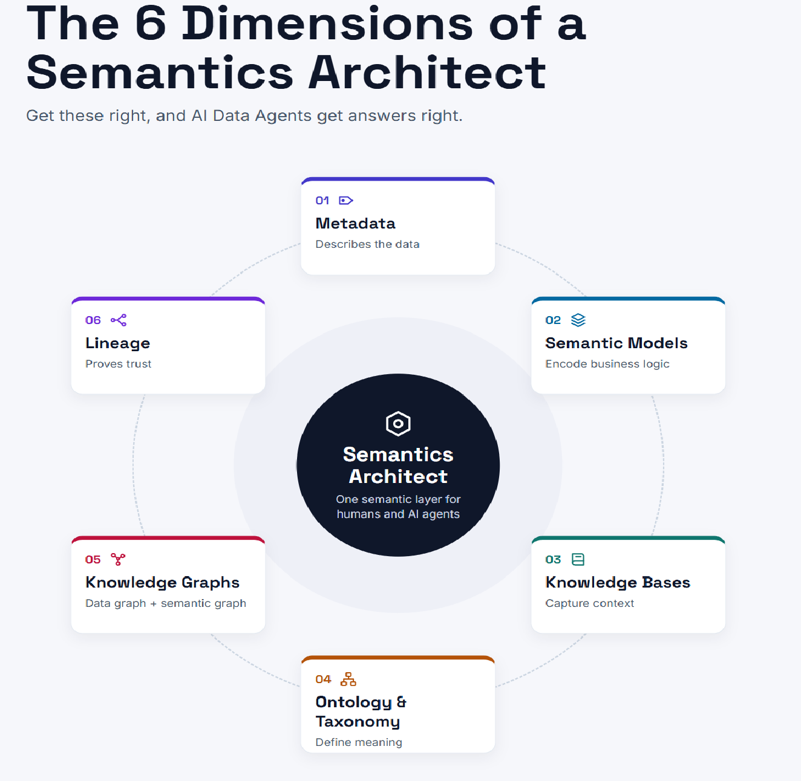
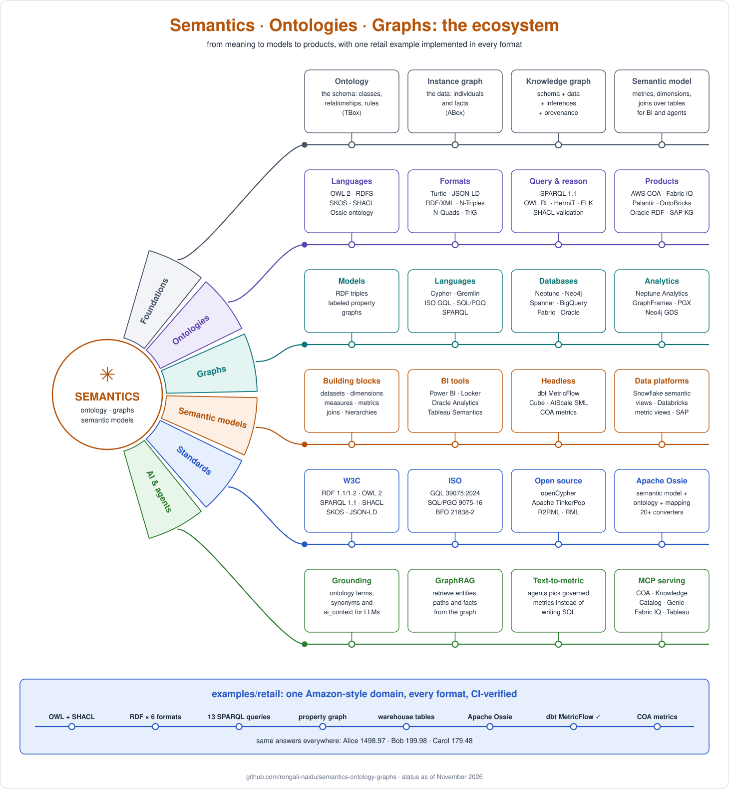
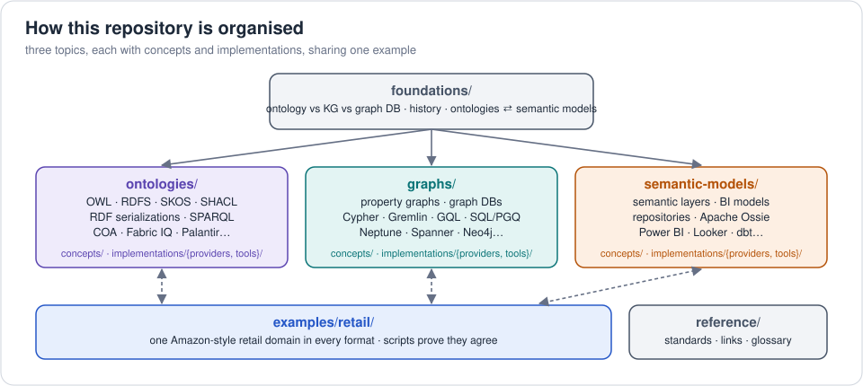
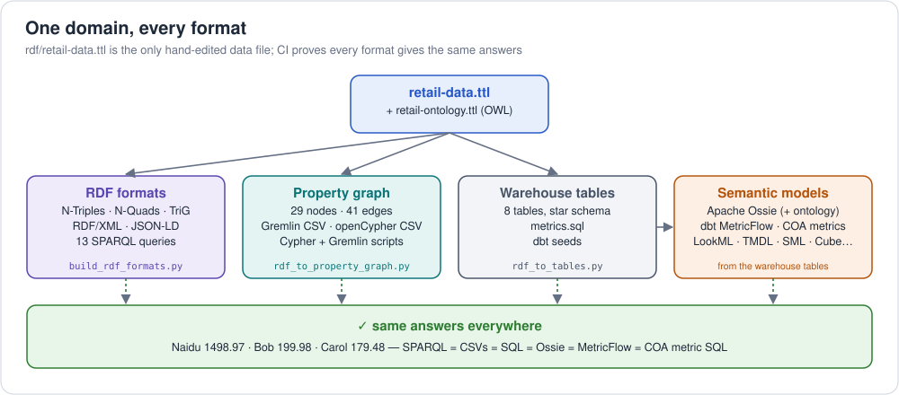

# semantics-ontology-graphs

[](https://github.com/rongali-naidu/semantics-ontology-graphs/actions/workflows/checks.yml)

A hands-on reference for **semantics** in three topics, **ontologies**,
**knowledge graphs** and **semantic models**, from first principles to the
products that implement them.

## The Semantics Architect

The concepts in this repo are the foundation of an emerging AI role, the
**Semantics Architect**: the person who designs and governs the shared
meaning of an organization's data, so that humans and AI agents get answers
that are accurate, explainable and trusted. The role spans six dimensions:
metadata, semantic models, knowledge bases, ontology and taxonomy,
knowledge graphs, and lineage.
More: [the Semantics Architect](foundations/06-semantics-architect.md).



## Why learn this now: data agents

Companies are putting **AI agents** in front of their data: "what was
revenue from premium customers last quarter, and who are they?" An LLM can
write SQL, but on its own it doesn't know what *your* business means: which
of five "revenue" columns is the right one, that "client" and "customer" are
the same thing, how tables join without double counting, or that Naidu in
the CRM is Naidu in the order system. So it gives fluent, confident,
**wrong** answers.

Each topic in this repo supplies one missing piece of context:

| | Gives the agent | Without it, the agent… |
|---|---|---|
| **Semantic model** | governed metrics, dimensions and joins: *how much?* | invents formulas and joins; numbers change between runs |
| **Ontology** | shared meaning: terms, synonyms, hierarchies, rules: *what does it mean?* | misreads business terms, misses that a premium customer is a customer |
| **Knowledge graph** (mostly *metadata*) | a connected map of business concepts, tables, columns, metrics, lineage and key entities: *where is it? how does it relate?* | can't find the right tables or metric among many sources, guesses join paths, can't resolve "Naidu" to one customer or explain where an answer came from |

That's why every major data platform now ships one or more of these for
agents: AWS Context Ontology Accelerator, Microsoft Fabric IQ, Google
Knowledge Catalog, Databricks Genie Ontology, Snowflake semantic views and
Cortex, Salesforce Tableau Semantics and Apache Ossie. Implementing a data
agent well means understanding all three, and how they fit together.
More: [what a data agent needs](foundations/04-data-agents.md) ·
[why it matters in the AI era](foundations/05-ai-era.md).

## What's here

One running example, an **Amazon-style retail ordering domain**, is
expressed in every form: an OWL ontology, RDF in six serializations, a
property graph, warehouse tables, an **Apache Ossie** semantic model, and
product formats from AWS, Google Cloud, Microsoft, Oracle, Snowflake,
Databricks, SAP, Salesforce, Palantir, NVIDIA, dbt, AtScale, Cube and Neo4j, and
[automated checks](#how-do-we-know-the-examples-are-right) prove they all
give the same answers.





## Start here

| If you are... | Read |
|---|---|
| new to all of it | [foundations](foundations/README.md), then any topic |
| wondering why any of this matters for AI | [foundations 5: the AI era](foundations/05-ai-era.md) |
| thinking about the role that owns all of this | [foundations 6: the Semantics Architect](foundations/06-semantics-architect.md) |
| comparing metadata, semantic models, knowledge bases, ontologies, taxonomies, knowledge graphs and lineage | [foundations 6.2: the six dimensions side by side](foundations/06-semantics-architect.md#62-the-six-dimensions-side-by-side) |
| wanting to try it in 10 minutes | the [quickstart notebook](notebooks/quickstart.ipynb) |
| new to ontologies / the Semantic Web | [ontologies](ontologies/README.md) |
| a developer looking at graph databases | [graphs](graphs/README.md) |
| from BI / analytics | [semantic models](semantic-models/README.md) |
| choosing between ontology and semantic layer for AI agents | [foundations 3: semantic models and ontologies](foundations/03-semantic-models-and-ontologies.md) |
| building a data agent | [foundations 4: what a data agent needs](foundations/04-data-agents.md) |
| a software engineer new to OWL | [ontologies 5: from OOP to OWL](ontologies/concepts/05-ontology-for-software-engineers.md) |
| mapping your tables to an ontology | [ontologies 7: R2RML, OBDA, ETL, LLM, COA](ontologies/concepts/07-mapping-ontology-to-tables.md) |
| deciding between a relational and a graph database | [graphs 4: RDBMS vs graph](graphs/concepts/04-relational-vs-graph.md) |
| looking for one provider | the [provider index](#provider-index) below |
| looking for a spec or a definition | [reference](reference/standards-links-glossary.md) |

## Provider index

The same provider appears in every topic where it has a product, so each
topic's page is complete on its own.

| Provider / tool | Ontologies | Graphs | Semantic models |
|---|---|---|---|
| **AWS** | [Context Ontology Accelerator, Neptune](ontologies/implementations/providers/aws/README.md) | [Neptune, Neptune Analytics, COA knowledge graph](graphs/implementations/providers/aws/README.md) | [COA metrics, QuickSight](semantic-models/implementations/providers/aws/README.md) |
| **Google Cloud** | [Knowledge Catalog context graph](ontologies/implementations/providers/gcp/README.md) | [Spanner Graph, BigQuery Graph](graphs/implementations/providers/gcp/README.md) | [Looker, Knowledge Catalog](semantic-models/implementations/providers/gcp/README.md) |
| **Microsoft** | [Fabric IQ, DTDL](ontologies/implementations/providers/microsoft/README.md) | [Fabric Graph, Cosmos DB](graphs/implementations/providers/microsoft/README.md) | [Power BI / Fabric](semantic-models/implementations/providers/microsoft/README.md) |
| **Oracle** | [RDF Graph](ontologies/implementations/providers/oracle/README.md) | [property graphs, Graph Studio](graphs/implementations/providers/oracle/README.md) | [Oracle Analytics](semantic-models/implementations/providers/oracle/README.md) |
| **Snowflake** | [Ontology on Snowflake, RelationalAI](ontologies/implementations/providers/snowflake/README.md) | [KG tables + graph analytics](graphs/implementations/providers/snowflake/README.md) | [semantic views](semantic-models/implementations/providers/snowflake/README.md) |
| **Databricks** | [Genie Ontology, OntoBricks](ontologies/implementations/providers/databricks/README.md) | [GraphFrames, OntoBricks](graphs/implementations/providers/databricks/README.md) | [metric views](semantic-models/implementations/providers/databricks/README.md) |
| **SAP** | [SAP Knowledge Graph, HANA Cloud](ontologies/implementations/providers/sap/README.md) | [HANA Cloud knowledge graph engine](graphs/implementations/providers/sap/README.md) | [Datasphere / Business Data Cloud](semantic-models/implementations/providers/sap/README.md) |
| **Salesforce** | — | — | [Tableau Semantics](semantic-models/implementations/providers/salesforce/README.md) |
| **Palantir** | [Foundry Ontology](ontologies/implementations/providers/palantir/README.md) | — | — |
| **NVIDIA** | [Auto Ontology, ontology-sql-eval](ontologies/implementations/providers/nvidia/README.md) | — | — |
| **Neo4j** | [neosemantics](ontologies/implementations/tools/neo4j-neosemantics/README.md) | [Neo4j](graphs/implementations/tools/neo4j/README.md) | — |
| **dbt** | — | — | [Semantic Layer / MetricFlow](semantic-models/implementations/tools/dbt/README.md) ✅ |
| **AtScale** | — | — | [SML](semantic-models/implementations/tools/atscale/README.md) |
| **Cube** | — | — | [Cube](semantic-models/implementations/tools/cube/README.md) |

Full product tables: [ontologies](ontologies/implementations/README.md) ·
[graphs](graphs/implementations/README.md) ·
[semantic models](semantic-models/implementations/README.md).

## The example at a glance



```
(:Customer)-[:PLACED]->(:Order)-[:CONTAINS {quantity, unitPrice}]->(:Product)-[:IN_CATEGORY]->(:Category)-[:SUBCATEGORY_OF]->(:Category)
(:Customer)-[:WROTE]->(:Review {rating})-[:REVIEWS]->(:Product)-[:SOLD_BY]->(:Seller)
```

3 customers · 4 orders · 7 order lines · 6 products · 6 categories (3
levels) · 3 sellers · 4 reviews.

> **About scale:** the example loads *everything*, orders included, into
> the graph because it's tiny. With real volumes, transactions stay in the
> warehouse and the graph holds meaning and metadata. See
> [what goes in the graph, and what stays in the warehouse](foundations/04-data-agents.md#42-what-goes-in-the-graph-and-what-stays-in-the-warehouse).


| Same data as... | Size | Revenue by customer |
|---|---|---|
| RDF (+ OWL ontology) | 165 triples (+ 238) | SPARQL → Naidu 1498.97 · Bob 199.98 · Carol 179.48 |
| Property graph | 29 nodes / 41 edges | Cypher / Gremlin → same |
| Warehouse tables | 8 tables | SQL → same |
| Semantic model | 8 datasets, 8 metrics | Ossie / MetricFlow / COA metrics → same |

## How do we know the examples are right?

The same retail data appears here in many forms: RDF files, a property
graph, warehouse tables, semantic models and product formats. With that
many copies, it's easy for one to drift and quietly give a different
answer. So the repo includes **automated checks**: small scripts that run
the examples and compare their answers with known results, for example
"Naidu's revenue is 1498.97" in every format.

GitHub runs them on every change. The **checks** badge at the top of this
page is green when everything passes and turns red if any example breaks.

| Check | What it proves |
|---|---|
| SPARQL queries | each query returns the answer the docs show |
| SHACL validation | the data obeys the ontology's rules, and 9 kinds of deliberately broken data are rejected |
| Reasoning demo | the inferences described in the chapters really happen (subclasses, inverses, defined classes…) |
| Format consistency | the 6 RDF files and the property-graph files contain exactly the same data |
| Semantic models | warehouse SQL, Apache Ossie and AWS COA metrics give the same numbers as SPARQL |
| R2RML mapping | mapping the tables back to the ontology rebuilds exactly the same knowledge graph |
| dbt + MetricFlow | a real semantic-layer engine computes the same numbers |
| Links and diagrams | every link in the docs works and the diagrams match the data |

**Not every page can be checked this way.** Products that need a paid
account or have no local version (Snowflake, Power BI, Neptune…) are
written from their documentation. Each product page says which kind it is:
see [verification levels](#verification-levels) below.

### Run the checks yourself (no cloud account needed)

```bash
make install          # install the pinned Python packages
make check            # everything in the table above except R2RML and dbt
pytest                # the same checks as unit tests (tests/)
make help             # all commands, including check-r2rml and dbt
```

The retail data is edited in one file only,
[`retail-data.ttl`](examples/retail/rdf/retail-data.ttl); `make generate`
rebuilds every other format from it ([details](CONTRIBUTING.md#the-data-rule)).

## Verification levels

Every product page starts with one of these labels and the date it was last
reviewed:

| Level | Meaning |
|---|---|
| ✅ **executed** | runs automatically on every change and matches the known answers |
| 🟡 **checked** | the files are validated automatically, but not run on the product itself |
| ⚪ **documented** | written from the product's documentation; not run (needs an account or service) |

| ✅ Executed | 🟡 Checked | ⚪ Documented |
|---|---|---|
| SPARQL queries + updates, SHACL, OWL RL reasoning | Neptune CSV + RDF load files | Cypher, Gremlin, GQL, SQL/PGQ scripts |
| 6 RDF serializations (isomorphic) | AWS COA metric definitions | COA deployment, Neptune loader + clients |
| Warehouse `metrics.sql` (SQLite) | AtScale SML, Cube model | Looker, Power BI, Oracle (design), Snowflake, Databricks |
| Apache Ossie model, ontology, mapping | | Spanner / BigQuery / Fabric Graph, DTDL, GraphFrames, Neo4j |
| dbt + MetricFlow (DuckDB) · R2RML mapping (Morph-KGC) | | |

Moving ⚪ items up is the plan in [ROADMAP.md](ROADMAP.md). If something
doesn't run on your product version, please open an issue or PR.

## Contributing

See [CONTRIBUTING.md](CONTRIBUTING.md) (data rule, adding a product,
verification levels) and [ROADMAP.md](ROADMAP.md) (what's next).

## License

* Code, scripts, queries, data and model files: [Apache 2.0](LICENSE)
* Documentation: [CC BY 4.0](LICENSE-docs.md)

Apache Ossie, AtScale SML, W3C/ISO standards and product formats referenced
here remain under their own licenses.
