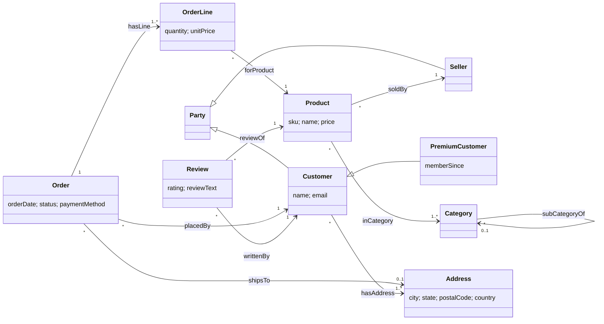

# 4. Ways to document (write down) an ontology

"Documenting" an ontology happens at three levels:

1. **Modelling language**: which vocabulary of modelling constructs you use
   (RDFS, OWL 2, SKOS, SHACL...).
2. **Serialization**: which file syntax you write it in (Turtle, RDF/XML,
   JSON-LD, Manchester...).
3. **Human documentation**: diagrams, generated HTML docs, competency
   questions, versioning and publishing.

---

## 4.1 Modelling languages (W3C stack)

| Language | Use it for | Key terms | Spec |
|---|---|---|---|
| **RDF** | The data model: triples `subject predicate object`, IRIs, literals, blank nodes, named graphs | `rdf:type`, `rdf:Property` | [RDF 1.1 Concepts](https://www.w3.org/TR/rdf11-concepts/) · [RDF 1.2 Concepts](https://www.w3.org/TR/rdf12-concepts/) |
| **RDFS** | Lightweight schema: classes, subclass/subproperty, domain/range, labels | `rdfs:Class`, `rdfs:subClassOf`, `rdfs:domain`, `rdfs:range`, `rdfs:label` | [RDF Schema 1.1](https://www.w3.org/TR/rdf11-schema/) |
| **OWL 2** | Rich logic: restrictions, cardinality, equivalence, disjointness, inverse/transitive/functional properties, property chains | `owl:Class`, `owl:ObjectProperty`, `owl:Restriction`, `owl:equivalentClass`, `owl:inverseOf`, `owl:TransitiveProperty` | [OWL 2 Overview](https://www.w3.org/TR/owl2-overview/) · [Primer](https://www.w3.org/TR/owl2-primer/) |
| **OWL 2 profiles** | Trade expressiveness for speed: **EL** (huge class hierarchies, e.g. SNOMED), **QL** (query rewriting over SQL), **RL** (rule engines / triple stores) | | [OWL 2 Profiles](https://www.w3.org/TR/owl2-profiles/) |
| **SKOS** | Taxonomies, thesauri, code lists — when you need *concepts* rather than formal classes | `skos:Concept`, `skos:broader`, `skos:prefLabel`, `skos:altLabel` | [SKOS Reference](https://www.w3.org/TR/skos-reference/) |
| **SHACL** | Validating data (closed world): "an Order must have exactly 1 date" | `sh:NodeShape`, `sh:property`, `sh:minCount`, `sh:datatype` | [SHACL](https://www.w3.org/TR/shacl/) |
| **ShEx** | Alternative validation language (compact grammar-like syntax) | | [ShEx](https://shex.io/shex-semantics/) |
| **SWRL / SHACL rules / SPARQL CONSTRUCT** | If-then rules beyond OWL | | [SWRL](https://www.w3.org/submissions/SWRL/) · [SHACL-AF](https://www.w3.org/TR/shacl-af/) |

**Metadata & reuse vocabularies** commonly mixed in:
[Dublin Core terms](https://www.dublincore.org/specifications/dublin-core/dcmi-terms/) (`dcterms:title`, `dcterms:creator`),
[PROV-O](https://www.w3.org/TR/prov-o/) (provenance),
[DCAT 3](https://www.w3.org/TR/vocab-dcat-3/) (datasets),
[VANN](https://vocab.org/vann/) (preferred prefix),
[schema.org](https://schema.org/) (general web entities),
[FOAF](http://xmlns.com/foaf/spec/) (people),
[OWL-Time](https://www.w3.org/TR/owl-time/), [GeoSPARQL](https://www.ogc.org/standard/geosparql/), [QUDT](https://www.qudt.org/) (units).

### RDFS vs OWL vs SHACL — which statement goes where?

| Requirement | RDFS | OWL | SHACL |
|---|---|---|---|
| PremiumCustomer is a kind of Customer | `rdfs:subClassOf` ✅ | ✅ | — |
| `placedBy` links Orders to Customers | `rdfs:domain/range` ✅ (infers types!) | ✅ | `sh:class` (checks types) |
| An order has exactly one customer | — | `owl:qualifiedCardinality 1` (infers / detects contradictions) | `sh:minCount 1; sh:maxCount 1` (reports missing/extra) |
| subCategoryOf is transitive | — | `owl:TransitiveProperty` ✅ | — |
| Rating between 1 and 5 | — | datatype restriction | `sh:minInclusive 1; sh:maxInclusive 5` ✅ |
| Email must match a regex | — | — | `sh:pattern` ✅ |

> ⚠️ `rdfs:domain` and `rdfs:range` are **not constraints**. If you write
> `ex:Bob retail:placedBy ex:P1` (a product!), a reasoner happily concludes
> that `ex:Bob` is an Order and `ex:P1` is a Customer. Use SHACL to *reject*
> such data.

The retail example uses all three:
[`retail-ontology.ttl`](../../examples/retail/ontology/retail-ontology.ttl)
(RDFS + OWL + SKOS annotations) and
[`retail-shapes.ttl`](../../examples/retail/ontology/retail-shapes.ttl) (SHACL).

---

## 4.2 Serializations — the same ontology snippet seven ways

Snippet: *PremiumCustomer is a subclass of Customer; placedBy goes from Order
to Customer; O1 was placed by C1.*

### Turtle (`.ttl`) — the one humans should write
[spec](https://www.w3.org/TR/turtle/)
```turtle
@prefix rdfs:   <http://www.w3.org/2000/01/rdf-schema#> .
@prefix owl:    <http://www.w3.org/2002/07/owl#> .
@prefix retail: <https://example.org/retail/ontology#> .
@prefix ex:     <https://example.org/retail/data/> .

retail:PremiumCustomer a owl:Class ;
    rdfs:subClassOf retail:Customer ;
    rdfs:label "Premium customer"@en .

retail:placedBy a owl:ObjectProperty ;
    rdfs:domain retail:Order ;
    rdfs:range  retail:Customer .

ex:O1 retail:placedBy ex:C1 .
```

### N-Triples (`.nt`) — one full triple per line; best for bulk loading, diffs, `grep`, splitting
[spec](https://www.w3.org/TR/n-triples/)
```
<https://example.org/retail/ontology#PremiumCustomer> <http://www.w3.org/1999/02/22-rdf-syntax-ns#type> <http://www.w3.org/2002/07/owl#Class> .
<https://example.org/retail/ontology#PremiumCustomer> <http://www.w3.org/2000/01/rdf-schema#subClassOf> <https://example.org/retail/ontology#Customer> .
<https://example.org/retail/ontology#PremiumCustomer> <http://www.w3.org/2000/01/rdf-schema#label> "Premium customer"@en .
<https://example.org/retail/ontology#placedBy> <http://www.w3.org/1999/02/22-rdf-syntax-ns#type> <http://www.w3.org/2002/07/owl#ObjectProperty> .
<https://example.org/retail/ontology#placedBy> <http://www.w3.org/2000/01/rdf-schema#domain> <https://example.org/retail/ontology#Order> .
<https://example.org/retail/ontology#placedBy> <http://www.w3.org/2000/01/rdf-schema#range> <https://example.org/retail/ontology#Customer> .
<https://example.org/retail/data/O1> <https://example.org/retail/ontology#placedBy> <https://example.org/retail/data/C1> .
```

### N-Quads (`.nq`) / TriG (`.trig`) — triples + a 4th element: the named graph
[N-Quads](https://www.w3.org/TR/n-quads/) · [TriG](https://www.w3.org/TR/trig/)
```
<https://example.org/retail/data/O1> <https://example.org/retail/ontology#placedBy> <https://example.org/retail/data/C1> <https://example.org/retail/graph/orders> .
```
```trig
@prefix retail: <https://example.org/retail/ontology#> .
@prefix ex:     <https://example.org/retail/data/> .
<https://example.org/retail/graph/orders> {
    ex:O1 retail:placedBy ex:C1 .
}
```
Named graphs are how you track **provenance / source / version** per batch of
triples.

### RDF/XML (`.rdf`, `.owl`) — the original 1999 syntax; still Protégé's default and common in older ontologies
[spec](https://www.w3.org/TR/rdf-syntax-grammar/)
```xml
<rdf:RDF xmlns:rdf="http://www.w3.org/1999/02/22-rdf-syntax-ns#"
         xmlns:rdfs="http://www.w3.org/2000/01/rdf-schema#"
         xmlns:owl="http://www.w3.org/2002/07/owl#"
         xmlns:retail="https://example.org/retail/ontology#">
  <owl:Class rdf:about="https://example.org/retail/ontology#PremiumCustomer">
    <rdfs:subClassOf rdf:resource="https://example.org/retail/ontology#Customer"/>
    <rdfs:label xml:lang="en">Premium customer</rdfs:label>
  </owl:Class>
  <owl:ObjectProperty rdf:about="https://example.org/retail/ontology#placedBy">
    <rdfs:domain rdf:resource="https://example.org/retail/ontology#Order"/>
    <rdfs:range  rdf:resource="https://example.org/retail/ontology#Customer"/>
  </owl:ObjectProperty>
  <rdf:Description rdf:about="https://example.org/retail/data/O1">
    <retail:placedBy rdf:resource="https://example.org/retail/data/C1"/>
  </rdf:Description>
</rdf:RDF>
```

### JSON-LD (`.jsonld`) — RDF for JSON/web developers; embedded in web pages for SEO (schema.org)
[spec](https://www.w3.org/TR/json-ld11/) · [playground](https://json-ld.org/playground/)
```json
{
  "@context": {
    "rdfs": "http://www.w3.org/2000/01/rdf-schema#",
    "owl": "http://www.w3.org/2002/07/owl#",
    "retail": "https://example.org/retail/ontology#",
    "ex": "https://example.org/retail/data/",
    "subClassOf": { "@id": "rdfs:subClassOf", "@type": "@id" },
    "domain": { "@id": "rdfs:domain", "@type": "@id" },
    "range": { "@id": "rdfs:range", "@type": "@id" },
    "label": { "@id": "rdfs:label", "@language": "en" },
    "placedBy": { "@id": "retail:placedBy", "@type": "@id" }
  },
  "@graph": [
    { "@id": "retail:PremiumCustomer", "@type": "owl:Class",
      "subClassOf": "retail:Customer", "label": "Premium customer" },
    { "@id": "retail:placedBy", "@type": "owl:ObjectProperty",
      "domain": "retail:Order", "range": "retail:Customer" },
    { "@id": "ex:O1", "placedBy": "ex:C1" }
  ]
}
```
The `@context` maps short JSON keys to IRIs — the same document is valid
plain JSON for an app *and* RDF for a knowledge graph.

### OWL Manchester Syntax (`.omn`) — the most readable for logicians; what Protégé shows in its class editor
[spec](https://www.w3.org/TR/owl2-manchester-syntax/)
```
Prefix: retail: <https://example.org/retail/ontology#>
Ontology: <https://example.org/retail/ontology>

ObjectProperty: retail:placedBy
    Domain: retail:Order
    Range:  retail:Customer
    Characteristics: Functional
    InverseOf: retail:placedOrder

Class: retail:PremiumCustomer
    Annotations: rdfs:label "Premium customer"@en
    SubClassOf: retail:Customer

Class: retail:Order
    SubClassOf: retail:placedBy exactly 1 retail:Customer,
                retail:hasLine min 1 retail:OrderLine
```

### OWL Functional Syntax (`.ofn`) / OWL/XML (`.owx`) — used by the OWL spec itself and by OWL API tools
[Functional syntax](https://www.w3.org/TR/owl2-syntax/) · [OWL/XML](https://www.w3.org/TR/owl2-xml-serialization/)
```
Prefix(retail:=<https://example.org/retail/ontology#>)
Ontology(<https://example.org/retail/ontology>
  Declaration(Class(retail:PremiumCustomer))
  SubClassOf(retail:PremiumCustomer retail:Customer)
  ObjectPropertyDomain(retail:placedBy retail:Order)
  ObjectPropertyRange(retail:placedBy retail:Customer)
  SubClassOf(retail:Order ObjectExactCardinality(1 retail:placedBy retail:Customer))
)
```

### Which format when?

| Format | Human-friendly | Streaming / bulk load | Named graphs | Neptune bulk loader |
|---|---|---|---|---|
| Turtle | ★★★ | ok | no | ✅ `turtle` |
| N-Triples | ★ | ★★★ | no | ✅ `ntriples` |
| N-Quads | ★ | ★★★ | ✅ | ✅ `nquads` |
| TriG | ★★★ | ok | ✅ | ❌ (convert to N-Quads) |
| RDF/XML | ★ | ok | no | ✅ `rdfxml` |
| JSON-LD | ★★ (devs) | ok | ✅ | ❌ (convert) |
| Manchester / Functional / OWL-XML | ★★★ (OWL) | — | — | ❌ (convert to Turtle/N-Triples) |

Every RDF file in [`examples/retail/rdf/`](../../examples/retail/rdf/) is
generated from `retail-data.ttl` by
[`build_rdf_formats.py`](../../examples/retail/scripts/build_rdf_formats.py), and
[`check_consistency.py`](../../examples/retail/scripts/check_consistency.py)
proves they are all the same graph (isomorphic). Conversion tools: `rdflib`
(Python), Apache Jena `riot`, `rapper` (Raptor), ROBOT `convert`, Protégé
"Save as".

---

## 4.3 Human-facing documentation

### Diagrams

* **Graffoo** (graphical framework for OWL), **Chowlk** (draw.io → OWL),
  **UML class diagrams / OntoUML**, **WebVOWL** (auto-generated interactive
  graph from an OWL file — https://service.tib.eu/webvowl/).
* A Mermaid diagram of the retail ontology (renders on GitHub):



### Generated reference docs

| Tool | What it does |
|---|---|
| [WIDOCO](https://github.com/dgarijo/Widoco) | Full HTML documentation site (+ WebVOWL diagram, changelog, metadata checks) |
| [pyLODE](https://github.com/RDFLib/pyLODE) | One-page HTML from OWL/SKOS/SHACL; `pip install pylode` then `pylode retail-ontology.ttl -o retail.html` |
| [Ontospy](https://github.com/lambdamusic/Ontospy) | CLI/HTML docs and stats |
| [LODE](https://essepuntato.it/lode/) | Original Live OWL Documentation Environment |
| [FOOPS!](https://foops.linkeddata.es/) / [OOPS!](https://oops.linkeddata.es/) | FAIRness and common-pitfall scanners |

### Editors & toolchains

[Protégé](https://protege.stanford.edu/) (desktop + WebProtégé, reasoners
HermiT/Pellet/ELK), [TopBraid EDG](https://www.topquadrant.com/),
[VocBench](https://vocbench.uniroma2.it/) (collaborative SKOS/OWL),
[ROBOT](https://robot.obolibrary.org/) (CI for ontologies: merge, reason,
report, convert), [Ontology Development Kit](https://github.com/INCATools/ontology-development-kit),
[rdflib](https://github.com/RDFLib/rdflib), [Apache Jena](https://jena.apache.org/),
[pySHACL](https://github.com/RDFLib/pySHACL), [owlready2](https://owlready2.readthedocs.io/).

### Methodology & good practice

1. **Start from competency questions** — the questions the ontology must
   answer. For retail: *Which products are in Electronics including
   subcategories? How much did each customer spend? What do buyers of X also
   buy?* Each one became a query in [`sparql/`](../../examples/retail/sparql/).
2. **Reuse** existing vocabularies (search [LOV](https://lov.linkeddata.es/),
   [BioPortal](https://bioportal.bioontology.org/), [OBO Foundry](https://obofoundry.org/))
   and align (`rdfs:subClassOf schema:Person`) instead of re-inventing.
3. **Stable, dereferenceable IRIs**: `https://w3id.org/<yours>/…` or your
   domain; never put versions in term IRIs; use `owl:versionIRI` for releases.
4. **Naming**: classes `UpperCamelCase` singular (`OrderLine`), properties
   `lowerCamelCase` verb phrases (`placedBy`), always an `rdfs:label` and a
   `skos:definition`.
5. **Separate TBox / ABox / shapes** into different files (and named graphs).
6. **Version and test**: keep ontologies in git, run a reasoner (consistency)
   and SHACL (data quality) in CI, publish a changelog.
7. Methodologies to read: *Ontology Development 101* (Noy & McGuinness, 2001 —
   the classic beginner guide), METHONTOLOGY, NeOn, LOT (Linked Open Terms).

Next: [5. Querying ontologies and RDF knowledge graphs](05-querying-rdf-sparql.md)
