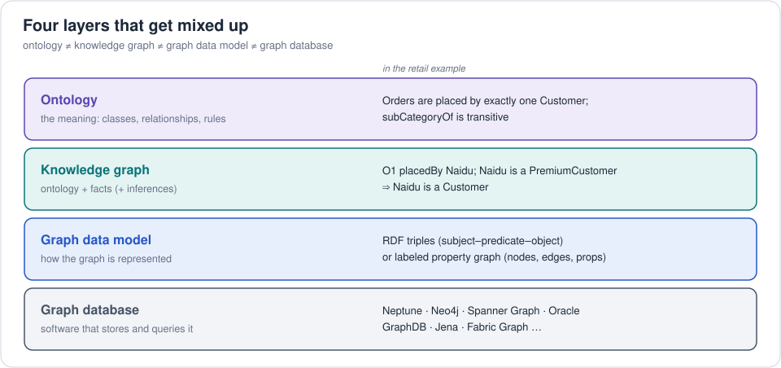
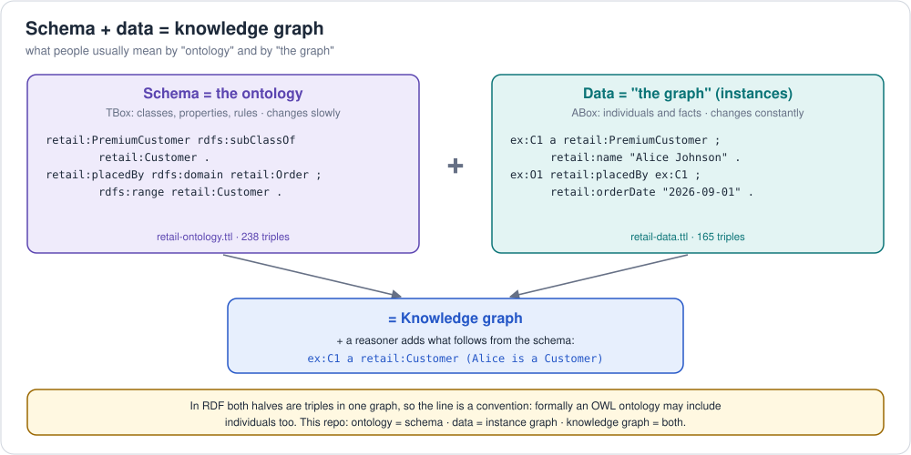
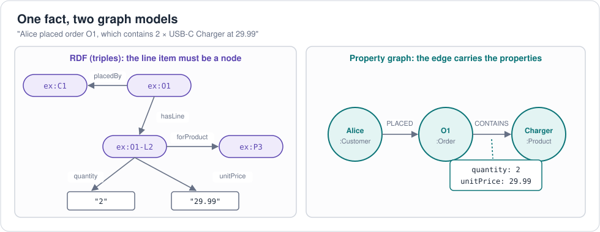

# 1. Ontology vs knowledge graph vs graph database

These three terms get mixed up all the time. They live at different layers:



| | Ontology | Knowledge graph | Graph database |
|---|---|---|---|
| What is it | A specification (a model) | A dataset (model + facts) | A piece of software |
| Answers | "What *can* exist and what must be true?" | "What *do* we know?" | "How do I store/query it fast?" |
| Size | Tens to thousands of terms | Thousands to billions of facts | n/a |
| Example | schema.org, FIBO, our retail TBox | Google KG, Wikidata, our retail graph | Neptune, Neo4j |
| Without the others? | Yes — you can publish an ontology as a file | Yes — a KG can live in files or even a relational DB | Yes — many graph DBs have no ontology at all |

## Schema vs data: what "ontology" and "the graph" usually mean



The everyday shorthand is:

> **ontology = schema** · **the graph = data** · **knowledge graph = schema + data**

| Term | Means | Retail example |
|---|---|---|
| **Ontology** (schema, *TBox*) | the classes, relationships and rules: what *can* exist and what must hold | [`retail-ontology.ttl`](../examples/retail/ontology/retail-ontology.ttl): Customer, Order, `placedBy`, "every Order has exactly one Customer" |
| **Instance data** (*ABox*), often just "the graph" | the individual things and facts | [`retail-data.ttl`](../examples/retail/rdf/retail-data.ttl): Naidu, order O1, "O1 placedBy Naidu" |
| **Knowledge graph** | both together, usually plus inferred facts and provenance | ontology + data + "Naidu is a Customer" (inferred from PremiumCustomer ⊑ Customer) |

Why the words get blurred:

* **Formally, an OWL ontology may contain individuals too.** An OWL file
  can hold `ex:C1 a retail:Customer`, and description logic calls TBox +
  ABox together a *knowledge base*. So some people say "ontology" for schema
  *plus* data. Neither usage is wrong; just say which you mean.
* **In RDF both halves are triples.** The schema (`retail:placedBy
  rdfs:domain retail:Order`) and the data (`ex:O1 retail:placedBy ex:C1`)
  sit in the same graph and are queried with the same SPARQL, so "the graph"
  can mean everything. Keeping them in separate files or named graphs is a
  convention that makes the split visible.
* **Property graphs have no separate schema graph.** The "schema" is the set
  of labels, relationship types and constraints, and "the graph" is always the
  data. That's one reason developers hear "graph" as "data".
* **Semantic layers use a third word.** A *semantic model* is the schema
  over tables (datasets, joins, metrics); the tables are the data
  ([foundations 3](03-semantic-models-and-ontologies.md)).

**This repo's convention:** *ontology* = schema (TBox), *data* or
*instance graph* = ABox, *knowledge graph* = both. That's why the retail
example keeps them in separate files (and in separate named graphs when
loaded into Neptune).

### Key point: you need none of them to use the others

* You can store an RDF knowledge graph **in a relational DB** (Ontop /
  R2RML virtual graphs) or just in **files**.
* You can run a **graph database without an ontology** — most Neo4j/Gremlin
  apps do: the "schema" is implicit in the code.
* An **ontology can sit over a property graph** too: the labels and
  relationship types *are* a vocabulary; you just don't get standard OWL
  reasoning over it.

### What makes a graph a *knowledge* graph?

There is no single official definition. Common requirements (Hogan et al.,
*Knowledge Graphs*, 2021; Ehrlinger & Wöß, 2016):

1. Entities and relationships of the real world, **as a graph**
2. A **schema/ontology** that defines types and relations
3. **Identity**: entities have stable, ideally global, identifiers (IRIs)
4. **Context/provenance**: where facts came from, when they're valid
5. Ability to **derive new knowledge** (reasoning, rules, ML/embeddings)
6. **Integrates** many sources

Under that lens: a property graph of orders in Neo4j is a *graph*; add a
governed vocabulary, global identifiers, provenance and reasoning and it
becomes a *knowledge graph*.

## Why graphs at all? The retail case

Questions like these are painful in SQL and natural in a graph:

| Question | SQL | Graph |
|---|---|---|
| All products under *Electronics*, any depth | recursive CTE | `subCategoryOf*` / `[:SUBCATEGORY_OF*0..]` |
| "Customers who bought X also bought..." | 4–5 self-joins | 4-hop path pattern |
| How is customer A connected to customer B? | very hard | path query |
| Add a new relation type (e.g. *gift for*) | schema migration | just add edges |

See [`retail-pgq.sql`](../examples/retail/property-graph/sql-pgq/retail-pgq.sql)
for the side-by-side.

**When NOT to use a graph:** simple CRUD on independent records, heavy
aggregate reporting over a few big tables (that's a warehouse's job), or when
you have no multi-hop questions.

## RDF graph vs property graph — preview



The same fact, "Naidu placed order O1 which contains 2 × USB-C Charger at
29.99", in the two models:

**RDF (triples)** — every fact is subject–predicate–object; the line item must
be a node of its own to carry `quantity` and `unitPrice`:

```turtle
ex:O1     retail:placedBy   ex:C1 .
ex:O1     retail:hasLine    ex:O1-L2 .
ex:O1-L2  retail:forProduct ex:P3 ;
          retail:quantity   2 ;
          retail:unitPrice  29.99 .
```

**Property graph** — relationships can have properties directly:

```cypher
(naidu:Customer)-[:PLACED]->(o1:Order)-[:CONTAINS {quantity: 2, unitPrice: 29.99}]->(charger:Product)
```

Full comparison in [graphs: property graphs](../graphs/concepts/01-property-graphs.md).

Next: [2. A short history](02-history.md)
