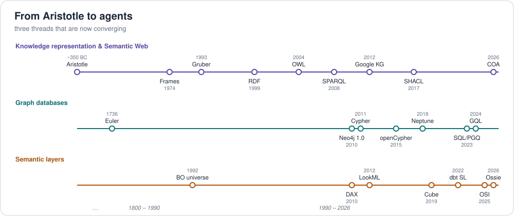

# 2. A short history: from Aristotle to GraphRAG

Three threads braid together: **philosophy** (what exists?), **AI knowledge
representation** (how do machines reason?), and **the Web + databases** (how
do we store and share connected data at scale?).



## Timeline

| Year | Milestone | Why it matters |
|---|---|---|
| ~350 BC | **Aristotle**, *Categories* | First attempt to classify everything that exists (substance, quantity, quality, relation...) |
| ~270 AD | **Porphyry's tree** | Genus → species hierarchy: the ancestor of every `subClassOf` |
| 1606/1613 | Term *ontologia* coined (Lorhard, then Goclenius) | "Study of being" |
| 1735 | **Linnaeus**, *Systema Naturae* | A practical, shared taxonomy with naming rules |
| 1736 | **Euler**, Seven Bridges of Königsberg | Birth of graph theory |
| 1879 | **Frege**, *Begriffsschrift* | Formal logic — the base for description logics |
| 1960s | **Semantic networks** (Quillian, 1968) | Concepts as nodes, relations as labeled links |
| 1970 | Codd's **relational model** | The dominant database model graphs would later complement |
| 1974 | **Frames** (Minsky) | Classes with slots and defaults (→ OWL classes & properties) |
| 1976 | **Entity-Relationship model** (Chen) | Conceptual modelling for databases |
| 1984 | **Cyc** (Lenat) begins | Decades-long effort to encode common sense |
| 1985 | **KL-ONE** (Brachman & Schmolze) | First description-logic system: classification by reasoning |
| 1985– | **WordNet** (Princeton) | Lexical ontology; synsets + hypernyms |
| 1989 | Berners-Lee proposes the **Web** | Links between documents → later, links between data |
| 1991 | DARPA Knowledge Sharing Effort (KIF, Ontolingua) | Portable, shareable ontologies |
| 1993 | **Gruber's definition** of ontology | "explicit specification of a conceptualization" |
| 1998 | Studer et al. refine it: *formal, shared* | |
| 1999 | **RDF** Model & Syntax — W3C Recommendation | Triples + URIs: data model of the Semantic Web |
| 2000–01 | **DAML**, **OIL**, **DAML+OIL** | Direct precursors of OWL |
| 2001 | "The Semantic Web", *Scientific American* (Berners-Lee, Hendler, Lassila) | The vision goes mainstream |
| 2004 | **RDF Schema** and **OWL** (1.0) — W3C Recs | Standard ontology languages |
| 2006 | **Linked Data** principles (Berners-Lee) | Use HTTP URIs, return RDF, link to other URIs |
| 2007 | **DBpedia**, **Freebase** | Large public knowledge graphs |
| 2008 | **SPARQL** 1.0 — W3C Rec | Standard RDF query language |
| 2009 | **OWL 2**, **SKOS** — W3C Recs; **TinkerPop / Gremlin** started | Richer ontologies; a graph traversal standard |
| 2010 | **Neo4j 1.0** | The first widely used property-graph database |
| 2011 | **schema.org** (Google, Microsoft, Yahoo, Yandex); **Cypher** introduced by Neo4j | Ontology at web scale; declarative graph queries |
| 2012 | **Google Knowledge Graph** ("things, not strings"); **Wikidata** launched | "Knowledge graph" becomes a household term |
| 2013 | **SPARQL 1.1** | Updates, aggregates, property paths, federation |
| 2014 | **RDF 1.1**, **JSON-LD 1.0** | Modernised RDF; RDF for JSON developers |
| 2015 | **openCypher** project | Cypher opened to other vendors |
| 2017 | **SHACL** — W3C Rec | Validation of RDF data |
| 2018 | **Amazon Neptune** GA (Gremlin + SPARQL) | Managed, multi-model graph DB on AWS |
| 2019 | ISO approves the **GQL** project | A standard property-graph language, like SQL for graphs |
| 2020 | **JSON-LD 1.1** | |
| 2021 | **BFO** published as ISO/IEC 21838-2 | First ISO top-level ontology |
| 2022 | **openCypher on Neptune** GA | Same property graph, two languages |
| 2023 | **SQL/PGQ** (ISO/IEC 9075-16); **Neptune Analytics** GA | Graph queries inside SQL; in-memory graph analytics on AWS |
| 2024 | **GQL** published (ISO/IEC 39075:2024); **GraphRAG** popularised | First new ISO database language since SQL; KGs as LLM grounding |
| 2024– | **RDF 1.2 / SPARQL 1.2** (with triple terms, the successor of RDF-star) in progress at W3C | Statements about statements — closes a big gap with property graphs |

## The two graph families

By ~2010 two communities had built "graph" technology from different starting
points:

```
            Semantic Web / Knowledge Representation           Databases / Developers
            ---------------------------------------           -----------------------
  goal      meaning, interoperability, inference              fast traversals, app development
  model     RDF triples (subject-predicate-object), IRIs      labeled property graph (nodes, edges, properties)
  schema    RDFS / OWL ontologies, SHACL                      optional; constraints/indexes; GQL graph types
  query     SPARQL                                            Cypher / openCypher, Gremlin, GQL
  stores    Jena, Virtuoso, GraphDB, Stardog, AllegroGraph    Neo4j, JanusGraph, TigerGraph, Memgraph
                          \                                  /
                           `---- Amazon Neptune: both ------'
```

Today the families are converging: RDF 1.2 adds edge-like statement
annotations, property-graph stores add schemas and standards (GQL), and
multi-model engines (Neptune, Stardog, GraphDB, Oxigraph, AllegroGraph) bridge
both.

## Key sources

* Gruber, T. (1993). *A translation approach to portable ontology specifications.* Knowledge Acquisition 5(2).
* Studer, R., Benjamins, V.R., Fensel, D. (1998). *Knowledge engineering: principles and methods.* Data & Knowledge Engineering 25.
* Berners-Lee, T., Hendler, J., Lassila, O. (2001). *The Semantic Web.* Scientific American.
* Berners-Lee, T. (2006). *Linked Data* design issues — https://www.w3.org/DesignIssues/LinkedData.html
* Singhal, A. (2012). *Introducing the Knowledge Graph: things, not strings.* Google blog.
* Hogan, A. et al. (2021). *Knowledge Graphs.* ACM Computing Surveys — free book: https://kgbook.org/
* Robinson, Webber, Eifrem. *Graph Databases* (O'Reilly) — free e-book from Neo4j.

Next: [3. Semantic models and ontologies: how they fit together](03-semantic-models-and-ontologies.md)
