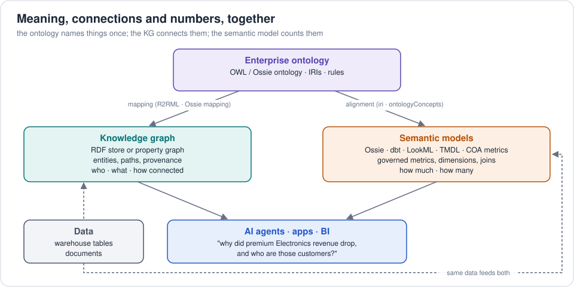

# 3. Semantic models and ontologies: how they fit together

"Semantic layer" and "ontology" both promise *meaning*, but they mean
different things by it.

## 4.1 One domain, four representations

The retail domain exists in this repo four times, and the checks prove
they agree:

| Representation | Optimised for | Files | Answers "revenue by customer" with |
|---|---|---|---|
| **OWL ontology + RDF** | meaning, integration, inference | `ontology/`, `rdf/` | SPARQL (`03-order-totals-per-customer.rq`) |
| **Property graph** | traversal, paths, recommendations | `property-graph/`, `graphs/implementations/providers/aws/*-csv` | Cypher / Gremlin |
| **Warehouse tables** | storage, bulk aggregation | `warehouse/` | SQL (`metrics.sql` M2) |
| **Semantic model** | governed metrics, BI, AI | `semantic-model/ossie/`, `semantic-models/implementations/*` | Ossie / MetricFlow / DAX / LookML |

All four say Alice 1498.97, Bob 199.98, Carol 179.48
(`check_consistency.py`, `check_semantic_model.py`, dbt `mf query`).

## 4.2 Side by side

| | Ontology (OWL/RDF) | Semantic model |
|---|---|---|
| Central question | What exists and how is it related? | How is each number calculated? |
| Main constructs | classes, properties, axioms, individuals | datasets, fields, joins, metrics |
| Relationships | first-class, named, any arity, any direction | joins (many → one) used to aggregate |
| Hierarchies | recursive (`subCategoryOf*`, any depth) | fixed levels (Level 1/2/3) |
| Identity | global IRIs, `owl:sameAs` | table keys |
| Aggregation | weak (SPARQL GROUP BY; no metric objects) | the core purpose |
| Reasoning | yes (subclass, inverse, transitive, chains) | no (but derived metrics, filters) |
| World assumption | open | closed |
| Scope | enterprise-wide, cross-domain | usually one subject area / data mart |
| Consumers | integration, search, apps, GraphRAG | dashboards, notebooks, text-to-SQL agents |

## 4.3 Mapping the concepts

| Ontology term | Semantic-model term | Retail example |
|---|---|---|
| Class | dataset / entity / dimension table | `retail:Customer` → `customers` |
| Subclass | boolean field or filter / segment | `PremiumCustomer` → `is_premium = true` |
| Datatype property | field / dimension | `retail:email` → `customers.email` |
| Object property (many-to-one) | relationship / join | `retail:placedBy` → `orders_to_customers` |
| Reified n-ary relation | fact table | `retail:OrderLine` → `order_lines` |
| Transitive hierarchy | flattened levels + hierarchy | `subCategoryOf*` → `category_level_1/2/3` |
| Property chain | multi-hop join path | `purchased` → order_lines → orders → customers |
| Aggregate rule | **metric** | Ossie `Customer.lifetime_revenue` ↔ `revenue` by customer |
| `rdfs:label`, `skos:altLabel` | label, synonyms, `ai_context` | "buyers", "shoppers" |
| SHACL shape | data tests / constraints | `rating BETWEEN 1 AND 5` |
| Individual (ABox) | rows | `ex:C1` ↔ `customers.customer_id = 'C1'` |

## 4.4 How they work together in practice

* The **ontology** names things consistently across domains; semantic
  models reuse its terms (Ossie lets each concept carry the OWL `iri`).
* The **semantic model** turns the ontology's facts into trustworthy
  numbers.
* The **knowledge graph** answers what tables can't: paths, recommendations,
  lineage, identity resolution, "how is X connected to Y".
* **AI agents** use both: the semantic layer for "how much", the graph for
  "who / what / how connected" (GraphRAG).

Vendors are converging on this pattern: Apache Ossie bundles ontology +
semantic model + mapping; Microsoft Fabric IQ puts an ontology over Power
BI semantic models and Fabric Graph; Snowflake describes Ossie as covering
both semantic layer and ontology; Palantir's Ontology and RelationalAI are
built on it.

## 4.5 Decision guide

| You need... | Start with |
|---|---|
| Consistent KPIs across dashboards | Semantic model |
| Text-to-SQL that doesn't hallucinate formulas | Semantic model with synonyms / AI context |
| A shared vocabulary across many systems and teams | Ontology |
| Data integration across sources with different keys | Ontology + knowledge graph |
| Recommendations, fraud rings, supply-chain paths | Property graph |
| Reasoning (classification, inheritance, consistency) | OWL ontology + reasoner |
| Explaining *why* an answer is what it is | Knowledge graph (paths, provenance) |
| All of the above for AI agents | Ontology → mapping → semantic model + KG |

Next: [4. Does a data agent need an ontology, a semantic model and a knowledge graph?](04-data-agents.md) · or pick a topic: [ontologies](../ontologies/README.md) · [graphs](../graphs/README.md) · [semantic models](../semantic-models/README.md)
