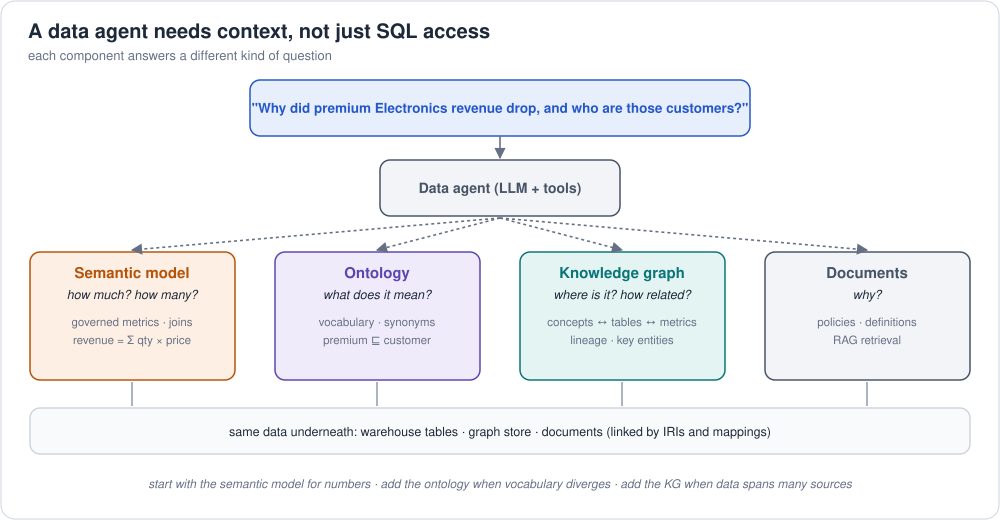
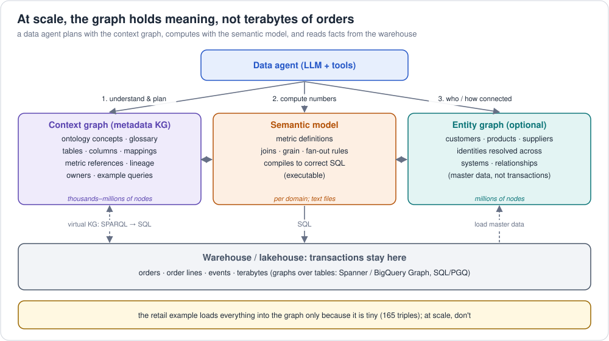

# 4. Does a data agent need an ontology, a semantic model and a knowledge graph?

A **data agent** is an LLM that answers questions about your data, or acts
on it, by calling tools (SQL, APIs, MCP servers) instead of answering from
memory. Most of its mistakes don't come from the LLM's reasoning; they come
from **missing context**: it doesn't know what "revenue" means here, which
table holds it, how tables join, or that "client" and "customer" are the same
thing.

The three components each supply a different kind of context.

## 4.1 What each component gives the agent

| Component | Answers | Without it, the agent… | Retail example |
|---|---|---|---|
| **Semantic model** (semantic layer) | **how much / how many**: governed metrics, dimensions, joins | writes its own SQL and invents a formula ("revenue = SUM(list_price)") or a join that double counts | `revenue = SUM(quantity × unit_price)`, `average_order_value = revenue / order_count`; Naidu's revenue is 1498.97 every time |
| **Ontology** | **what does this mean**: vocabulary, synonyms, class hierarchy, rules, what is allowed | confuses terms ("buyer", "client", "account"), misses subclasses, can't tell which concept a question is about | "premium members" = `PremiumCustomer`; a PremiumCustomer **is** a Customer; every Order has exactly one Customer |
| **Knowledge graph**: mostly a *context graph* of metadata, optionally key entities ([4.2](#42-what-goes-in-the-graph-and-what-stays-in-the-warehouse)) | **where is it, how does it relate**: concepts ↔ tables ↔ columns ↔ metrics ↔ lineage across many sources; resolved entities (customers, products) | picks the wrong table or metric among many sources, guesses join paths, can't resolve "Naidu" to one customer, can't explain where an answer came from | "revenue" → metric *revenue* in the *sales* model → `order_lines` ⋈ `orders`; "Naidu" → customer `C1` |
| *(Documents)* | **why**: policies, definitions, rationale (RAG) | has numbers but can't explain them | "what counts as a delivered order?" |

## 4.2 What goes in the graph, and what stays in the warehouse

The retail example loads *everything*, orders included, into the graph,
because it's tiny (165 triples). **At scale nobody does that.** Copying
terabytes of orders into a graph database is slow, expensive and
duplicates the warehouse. For data agents the knowledge graph usually holds
**meaning and metadata, not transactions**:

| Layer | Holds | Typical size | Lives in |
|---|---|---|---|
| **Context graph** (metadata knowledge graph) | ontology concepts, glossary terms and synonyms, tables and columns, **mappings** (column → concept), **references to** semantic-model metrics, lineage, owners, data quality, example questions and queries | thousands to a few million nodes | a graph store or a catalog |
| **Entity graph** (optional) | master and reference data: customers, products, suppliers, locations, their relationships and **resolved identities** across systems | millions of nodes | a graph store |
| **Transactions** | orders, order lines, payments, clicks, events | billions of rows, terabytes | **the warehouse / lakehouse**, nowhere else |

How the agent still reaches the transactions:

* **Through the semantic model**: the agent picks a metric; the layer
  generates SQL against the warehouse.
* **Through a virtual knowledge graph**: the ontology plus R2RML mappings
  let an engine (Ontop, Stardog, AWS COA's VKG) rewrite a SPARQL question
  into SQL at query time. It looks like a graph, but nothing is copied
  ([ontologies 7](../ontologies/concepts/07-mapping-ontology-to-tables.md)).
* **Through a graph declared over the tables**: SQL/PGQ, Spanner Graph,
  BigQuery Graph and Fabric Graph traverse warehouse tables as a graph
  without loading them elsewhere.

The evidence for "a metadata graph helps SQL generation" is exactly this
setup: data.world's benchmark gave GPT-4 the **ontology and mappings** of
the database, not a copy of its rows, and accuracy rose from 16.7% to 54.2%
([foundations 5](05-ai-era.md#52-the-evidence-read-with-care)).
Product designs follow the same split: Google Knowledge Catalog's context
graph has tables, semantic models and glossary terms as nodes; AWS COA keeps
the ontology in Neptune and reaches the data virtually; Databricks Genie
Ontology mines metadata and query history.

## 4.3 Isn't that redundant? A semantic model *and* a graph of semantic-model information

Both can describe the same relationship (`orders.customer_id → customers`),
so it's a fair question. They hold the same *fact* but do different *jobs*:

| | Semantic model | Context graph |
|---|---|---|
| Job | **execute**: compile a question into correct SQL | **understand and route**: find the right concept, metric, table or domain |
| Knows about a join | grain, fan-out, many-to-one direction; how to aggregate without double counting | what the relationship *means* (`placedBy`), its inverse, the concept hierarchy, synonyms |
| Scope | one domain or subject area (sales, finance…) | the whole enterprise: **many** semantic models, glossaries, sources |
| Answers | "revenue by customer last quarter" | "which metric means *revenue* here? which model owns it? which tables feed it? what's related to *churn*?" |
| Without the other | can't tell which of five "revenue" metrics the user means | can describe metrics but can't compute them reliably |

So the graph should hold **references** to semantic-model elements (metric
`revenue` → defined in model *sales*, about concept `retail:OrderLine`),
plus the meaning around them, **not a second copy of the definitions**.

**Where redundancy really hurts** is two *hand-maintained* definitions of
the same join or metric, which drift apart. The fix is **one source of
truth, derived or checked everywhere else**:

* define the relationship once (ontology + mapping, or the semantic model);
* generate or verify the other side from it, as tools do: Fabric IQ drafts
  its ontology *from* a Power BI model; AWS COA links metrics to ontology
  concepts (`ontologyConcepts`); Apache Ossie links model fields to ontology
  concepts in a mapping document;
* test that they agree. This repo does it for the retail example: the
  foreign key `orders.customer_id` is `retail:placedBy` in the ontology, a
  column map in R2RML, the `orders_to_customers` relationship in Ossie and
  the `PLACED` edge in the property graph, and CI proves they all give the
  same answers.

## 4.4 Do you need all three?

Not on day one. Choose by the questions the agent must answer:

| Your agent mainly answers… | Minimum you need | Add next |
|---|---|---|
| KPI questions over a warehouse ("revenue by month") | **semantic model** (with synonyms / AI context) | ontology for vocabulary across many models |
| questions across many systems and teams with inconsistent names | **ontology** (shared vocabulary) + semantic models per domain | knowledge graph for identity resolution |
| relationship questions ("who is connected to whom", recommendations, lineage, fraud) | **knowledge graph** | semantic model for any metrics on top |
| a mix, in production, with audit requirements | **all three**, linked: ontology terms ↔ semantic-model fields ↔ KG entities | governance, tests, human approval of mappings |

Rule of thumb: **semantic model first for numbers, ontology when vocabulary
gets inconsistent, knowledge graph when data and metrics span many sources
(a context graph) or when the questions themselves are about relationships
(an entity graph).**

## 4.5 How they work together in one question

*"Why did revenue from premium customers in Electronics drop last month, and
who are those customers?"*

1. **Ontology** maps the words: "premium customers" → `retail:PremiumCustomer`
   (⊑ `Customer`), "Electronics" → `CAT-ELECTRONICS` *including its
   subcategories* (`subCategoryOf` is transitive), "revenue" → the
   governed `revenue` metric (Ossie `iri`, COA `ontologyConcepts`).
2. **Semantic model** computes the number with the approved definition:
   `revenue` by `order_month`, filtered to `is_premium = true` and
   `category_level_1 = 'Electronics'`. The agent picks a metric instead of
   writing SQL.
3. **Knowledge graph** (context graph) finds *where* and *how*: the
   `revenue` metric lives in the *sales* semantic model over `order_lines` ⋈
   `orders`; "premium" maps to `customers.is_premium`; Electronics includes
   its subcategories. If an entity graph exists, it also resolves *who* the
   premium customers are across systems. The transactions themselves are read
   from the warehouse, not from the graph.
4. **Documents** (optional) explain "why": a promotion ended, a policy
   changed.

Each step is **checkable**: the metric is defined once, the vocabulary is
explicit, and the graph path can be shown to a human.

## 4.6 How products package this (November 2026)

| Product | Semantic model | Ontology | Knowledge graph | Agent interface |
|---|---|---|---|---|
| [AWS Context Ontology Accelerator](../ontologies/implementations/providers/aws/README.md) | Tier-1 metrics | OWL (induced + approved) | Neptune + virtual KG | MCP (6 tools), tiered routing |
| [Microsoft Fabric IQ](../ontologies/implementations/providers/microsoft/README.md) | Power BI semantic models | Fabric IQ ontology | Fabric Graph | Fabric data agents, Copilot |
| [Google Knowledge Catalog](../ontologies/implementations/providers/gcp/README.md) | LookML, MetricFlow, … ingested | glossary / context graph | context graph, BigQuery Graph | Gemini agents |
| [Databricks](../ontologies/implementations/providers/databricks/README.md) | metric views | Genie Ontology (learned) / OntoBricks (OWL) | OntoBricks triple store | Genie, MCP |
| [Snowflake](../semantic-models/implementations/providers/snowflake/README.md) | semantic views | Ontology on Snowflake / RelationalAI | KG tables | Cortex Agents |
| [Salesforce](../semantic-models/implementations/providers/salesforce/README.md) | Tableau Semantics | — | — | Agentforce, Tableau Next MCP |
| [Palantir](../ontologies/implementations/providers/palantir/README.md) | — | Foundry Ontology (with actions) | object graph | AIP agents |

The pattern is the same everywhere: **metrics for numbers, an ontology for
meaning, a graph for connections**, served to the agent as tools.

## 4.7 Practical checklist

* **Start with the questions.** Write 20 real questions; classify each as
  *how much*, *what does it mean*, *who/how connected* or *why*.
* **Give metrics names, definitions and synonyms** before giving the agent
  SQL access ([semantic models 1](../semantic-models/concepts/01-what-is-a-semantic-model.md)).
* **Make vocabulary explicit**: labels, synonyms, definitions in the ontology
  or the semantic model's `ai_context`.
* **Link the layers**: ontology IRIs in the semantic model (Ossie `iri`,
  COA `ontologyConcepts`), mappings from tables to the ontology
  ([ontologies 7](../ontologies/concepts/07-mapping-ontology-to-tables.md)).
* **Keep humans in the loop** for generated ontologies and mappings.
* **Test answers against known results**, as this repo's CI does: SPARQL =
  SQL = MetricFlow = Ossie = COA metric SQL.

Next: [5. Why this matters in the AI era](05-ai-era.md) · back to [foundations](README.md)
