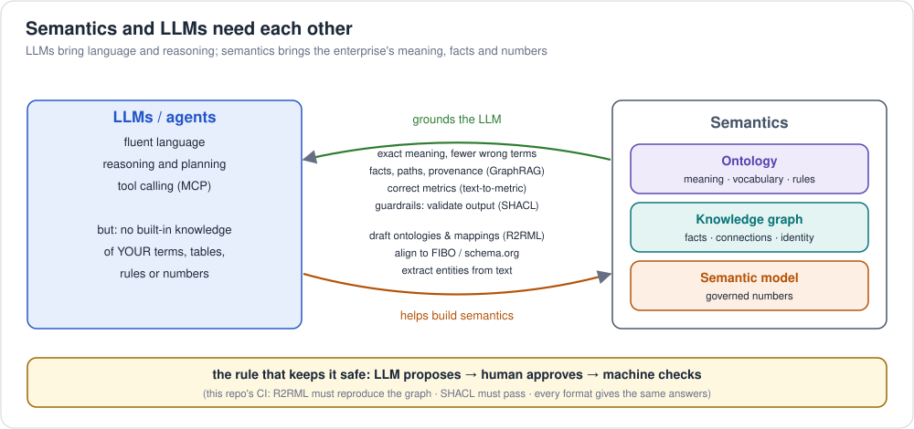

# 5. Why ontologies, graphs and semantic models matter in the AI era

Large language models changed who asks questions of data: increasingly it's
an agent, not an analyst writing SQL. That raised the stakes for the three
topics in this repo, because **an LLM is fluent but has no built-in
knowledge of *your* business**: what "revenue" means here, which table holds
it, that "client" and "customer" are the same thing, or that Naidu in the CRM
is Naidu in the order system.

## 5.1 What LLMs get wrong on enterprise data, and what fixes it

| LLM failure on enterprise data | Root cause | What fixes it | This repo |
|---|---|---|---|
| Invents a metric formula or join; numbers change between runs | no governed definitions | **semantic model**: the agent picks `revenue`, the layer writes the SQL | [semantic models](../semantic-models/README.md), [foundations 4](04-data-agents.md) |
| Misreads business terms; misses subclasses ("premium customers" are customers) | no shared vocabulary | **ontology**: classes, synonyms, hierarchy, rules | [ontologies](../ontologies/README.md) |
| Can't answer multi-hop questions ("who bought X also bought…", "how is A linked to B") | relationships buried in join chains | **knowledge graph**: explicit entities, edges, paths | [graphs](../graphs/README.md) |
| Confuses entities with the same name, or misses that two records are one | no identity | **knowledge graph** with global identifiers (IRIs), `owl:sameAs`, entity resolution | [ontologies 1](../ontologies/concepts/01-what-is-an-ontology.md) |
| Can't say where an answer came from | no provenance | graph paths, named graphs, metric lineage | [graphs 1](../graphs/concepts/01-property-graphs.md) |
| Produces output that breaks business rules | no machine-checkable constraints | **SHACL** / ontology constraints to validate LLM output before use | [`retail-shapes.ttl`](../examples/retail/ontology/retail-shapes.ttl) |

Vector search (plain RAG) helps an LLM *find relevant text*. It doesn't give
it exact numbers, explicit relationships, hierarchies or rules. That's the
gap the three topics fill.

## 5.2 The evidence (read with care)

* **Knowledge graphs for text-to-SQL.** data.world's benchmark on an
  insurance-domain enterprise schema (Sequeda, Allemang, Jacob, 2023):
  GPT-4 answered **16.7%** of questions correctly over raw SQL, and
  **54.2%** when given a knowledge-graph (ontology + mappings)
  representation of the same database. A follow-up added ontology-based
  query checking and LLM repair and reported **72.55%**. *Caveat: the
  authors' own benchmark and method.*
* **GraphRAG.** Microsoft's *From Local to Global* (Edge et al., 2024)
  builds an entity graph and community summaries from documents; on
  ~1M-token corpora it beat vector RAG on comprehensiveness and diversity for
  "global" questions ("what are the main themes?"). *Caveats: evaluated by
  an LLM judge on two corpora; vector RAG stays better for short fact
  lookups.*
* **The industry bet.** Every major data platform shipped an ontology,
  context-graph or semantic-layer feature for agents in 2025–2026: AWS
  Context Ontology Accelerator, Microsoft Fabric IQ, Google Knowledge
  Catalog, Databricks Genie Ontology, Snowflake semantic views and Cortex,
  Salesforce Tableau Semantics, SAP Knowledge Graph, Apache Ossie
  ([provider index](../README.md#provider-index)).

## 5.3 How each one is used with LLMs today

### Ontologies
* **Grounding and disambiguation**: labels, synonyms and definitions map the
  user's words to exact concepts (`"buyers"` → `retail:Customer`).
* **Guardrails**: allowed relationships, cardinalities and value ranges
  constrain what an agent may generate or do (SHACL validation of LLM output;
  Palantir-style *action types*).
* **Interoperability between agents**: a shared vocabulary is a contract
  that tools and agents from different teams can rely on (for example, MCP
  tools whose inputs and outputs use ontology terms).
* **Text-to-SPARQL / text-to-Cypher** works better when the model is given
  the ontology instead of a raw schema.

### Knowledge graphs
* **GraphRAG**: retrieve entities, neighbourhoods and paths instead of (or
  as well as) text chunks; answers can cite the path.
* **Agent memory**: long-lived facts about users, entities and past actions
  stored as a graph rather than a growing prompt.
* **Multi-hop reasoning and recommendations**: traversals do the joins the
  LLM would otherwise improvise.
* **Entity resolution**: one node per real thing, linked to every source.

### Semantic models
* **Text-to-metric instead of text-to-SQL**: the agent chooses governed
  metrics and dimensions; the layer generates correct SQL
  (dbt MetricFlow, Snowflake semantic views, COA Tier-1 metrics, Power BI).
* **AI context**: synonyms, descriptions and instructions on every metric
  (Ossie `ai_context`, COA `aiContext`, Tableau / Cortex synonyms).
* **Consistency**: dashboards, notebooks and agents give the *same* number.

## 5.4 It works both ways: LLMs build semantics

Building ontologies and mappings used to be the expensive part. LLMs now
draft most of it, with humans approving:

| Task | How LLMs help | Examples |
|---|---|---|
| Draft an ontology from schemas or documents | propose classes, properties, relationships | AWS COA induction, OntoBricks "Generate", Fabric IQ from a semantic model |
| Align to standards | match new classes to FIBO, schema.org | COA grounding, Agent-OM, LogMap with LLM |
| Map tables to the ontology | propose column → property mappings (R2RML) | COA, OntoBricks auto-map ([ontologies 7](../ontologies/concepts/07-mapping-ontology-to-tables.md)) |
| Build a graph from text | extract entities and relations | GraphRAG indexing, Oracle and Neo4j KG builders |
| Write metric definitions and synonyms | draft descriptions, synonyms, examples | Snowflake Semantic View Autopilot, Genie Ontology snippets |

The rule that keeps this safe: **LLM proposes → human approves →
machine checks.** This repo's CI is the "machine checks" part in miniature:
the R2RML mapping must reproduce the known graph, SHACL must pass, and every
format must give the same answers.

## 5.5 When it's overkill

* A single dashboard on one well-designed star schema needs a **semantic
  model**, not an ontology or a graph.
* Q&A over a pile of documents with no structured data: start with **vector
  RAG**; add GraphRAG if "global" questions matter.
* An ontology no one maintains becomes a liability. Start from the
  **competency questions** the agent must answer, and model only what they need.
* Graph databases don't replace the warehouse
  ([graphs 4](../graphs/concepts/04-relational-vs-graph.md)).

## 5.6 Summary

| | Gives an AI system | Without it |
|---|---|---|
| **Ontology** | meaning: what things are, how they relate, what's allowed | ambiguity, inconsistent terms, no guardrails |
| **Knowledge graph** | a connected map of concepts, data, metrics and key entities, with identity and provenance (mostly metadata; transactions stay in the warehouse) | wrong tables and joins, unresolved entities, no "why this answer" |
| **Semantic model** | correct, consistent numbers | plausible but wrong metrics |

LLMs bring language and reasoning; these three bring **the enterprise's
meaning, facts and numbers**. The combination is what makes agents
trustworthy enough to use.

Sources: [Sequeda, Allemang, Jacob 2023](https://arxiv.org/abs/2311.07509) ·
[Allemang, Sequeda 2024](https://arxiv.org/abs/2405.11706) ·
[Edge et al. 2024 (GraphRAG)](https://arxiv.org/abs/2404.16130) ·
[microsoft/graphrag](https://github.com/microsoft/graphrag)

Next: [6. The Semantics Architect](06-semantics-architect.md) · back to [foundations](README.md)
