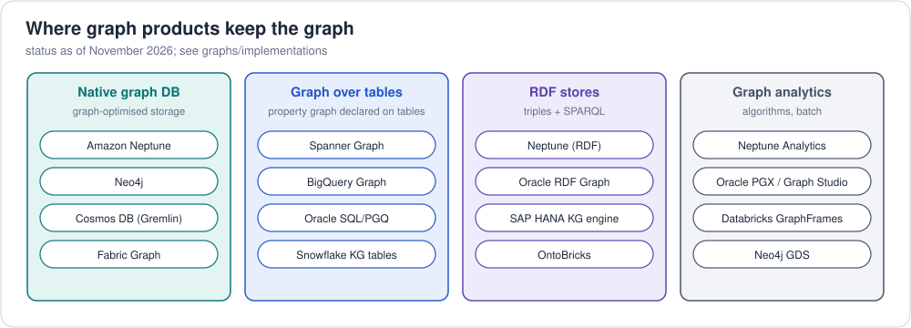

# 2. Graph databases

A graph database stores nodes and relationships natively and makes
multi-hop traversal cheap. They split by data model.

## 2.1 Landscape

### RDF triple stores (SPARQL)

| Database | Notes |
|---|---|
| [Amazon Neptune](https://aws.amazon.com/neptune/) | Managed AWS; RDF **and** property graph (separately); no built-in OWL reasoning |
| [Ontotext GraphDB](https://graphdb.ontotext.com/) | RDFS/OWL RL reasoning, SHACL, full-text, popular in enterprise KGs |
| [Stardog](https://www.stardog.com/) | Reasoning, virtual graphs over SQL/NoSQL, GraphQL, KG platform |
| [Apache Jena / Fuseki](https://jena.apache.org/) | Open-source Java framework + SPARQL server (TDB2) |
| [OpenLink Virtuoso](https://virtuoso.openlinksw.com/) | Hybrid SQL/RDF; powers DBpedia |
| [AllegroGraph](https://allegrograph.com/) | RDF + reasoning + "neuro-symbolic" LLM features |
| [RDFox](https://www.oxfordsemantic.tech/) | In-memory, very fast incremental Datalog reasoning |
| [Oxigraph](https://github.com/oxigraph/oxigraph) | Lightweight Rust store, embeddable (also in Python: `pyoxigraph`) |
| [QLever](https://github.com/ad-freiburg/qlever) | Very fast on huge read-mostly datasets (full Wikidata) |
| [Blazegraph](https://github.com/blazegraph/database) | Historic Wikidata engine; no longer developed (its team joined AWS for Neptune) |

### Property-graph databases (Cypher / Gremlin / GQL)

| Database | Query languages | Notes |
|---|---|---|
| [Neo4j](https://neo4j.com/) | Cypher (converging with GQL) | Most popular graph DB; AuraDB managed; Graph Data Science library |
| [Amazon Neptune Database](https://aws.amazon.com/neptune/) | Gremlin, openCypher | Managed, HA, read replicas, serverless option |
| [Amazon Neptune Analytics](https://aws.amazon.com/neptune/analytics/) | openCypher | In-memory analytics + graph algorithms + vector search |
| [JanusGraph](https://janusgraph.org/) | Gremlin | Open source; storage on Cassandra/HBase/ScyllaDB |
| [TigerGraph](https://www.tigergraph.com/) | GSQL, openCypher/GQL | MPP, deep-link analytics |
| [Memgraph](https://memgraph.com/) | Cypher | In-memory, streaming |
| [ArangoDB](https://arangodb.com/) | AQL | Multi-model (document + graph) |
| [Azure Cosmos DB for Gremlin](https://learn.microsoft.com/azure/cosmos-db/gremlin/) | Gremlin | Multi-region managed |
| [Google Spanner Graph](https://cloud.google.com/spanner/docs/graph/overview) | GQL + SQL | Graph over Spanner tables, ISO GQL syntax |
| [Kùzu](https://kuzudb.com/) | Cypher | Embedded columnar graph DB |
| [FalkorDB](https://www.falkordb.com/) | Cypher | Redis-module lineage, GraphRAG focus |
| [Apache AGE](https://age.apache.org/) | openCypher inside PostgreSQL | Graph extension for Postgres |
| [Dgraph](https://dgraph.io/) | DQL / GraphQL | Distributed, GraphQL-native |
| [NebulaGraph](https://www.nebula-graph.io/) | nGQL, openCypher | Distributed, large scale |

### Relational with graph features

* **SQL/PGQ** (ISO 9075-16): Oracle Database 23ai, DuckDB (`duckpgq`), more
  coming — see [`retail-pgq.sql`](../../examples/retail/property-graph/sql-pgq/retail-pgq.sql).
* **SQL Server** graph tables (`MATCH` clause), **PostgreSQL** recursive CTEs / Apache AGE.

### Multi-model / bridging RDF and LPG

Neptune (both models, separate stores), Stardog (Edge properties via RDF-star),
GraphDB (RDF-star), AllegroGraph, Oxigraph, and RDF 1.2-capable stores are
closing the gap.

## 2.2 Choosing one — questions to ask

| Question | Leans RDF | Leans property graph |
|---|---|---|
| Need to integrate many sources with shared meaning? | ✅ | |
| Need OWL/RDFS reasoning or SHACL? | ✅ | |
| Publishing / consuming linked open data (Wikidata, DBpedia)? | ✅ | |
| App developers want an intuitive query language and drivers? | | ✅ |
| Lots of edge attributes (weights, timestamps, quantities)? | (RDF 1.2) | ✅ |
| Heavy graph algorithms (PageRank, communities)? | | ✅ |
| Want both and managed on AWS? | Neptune (SPARQL) | Neptune (Gremlin/openCypher) |

Other factors: scale (single machine vs distributed), transactions/ACID,
HA & read replicas, managed vs self-hosted, license, vector search for
GraphRAG, ecosystem (BI connectors, notebooks, visualisation).

## 2.3 How graph databases store data (in brief)

* **Native graph storage** (Neo4j): records for nodes/relationships with
  direct pointers → *index-free adjacency*.
* **Triple/quad indexes** (most RDF stores, Neptune): every statement stored
  in several sort orders (e.g. SPOG, POGS, GPSO) so any pattern with bound
  positions is an index range scan. Neptune stores *both* RDF and property
  graph data as quads internally.
* **Wide-column backends** (JanusGraph on Cassandra): adjacency lists as rows.
* **Columnar / CSR in-memory** (Neptune Analytics, Kùzu, TigerGraph): optimised
  for scans and algorithms.

## 2.4 Visualisation & tooling

Neo4j Bloom / Browser, **Graph Explorer** (open source, works with Neptune
and other Gremlin/openCypher/SPARQL endpoints —
https://github.com/aws/graph-explorer), **graph-notebook** (Jupyter magics
for Neptune and others — https://github.com/aws/graph-notebook), G.V(),
Linkurious, Gephi, yEd, Cytoscape, KeyLines/ReGraph, Ontotext Graph
Explorer, WebVOWL (ontologies).

Next: [3. Querying property graphs](03-querying-property-graphs.md)
