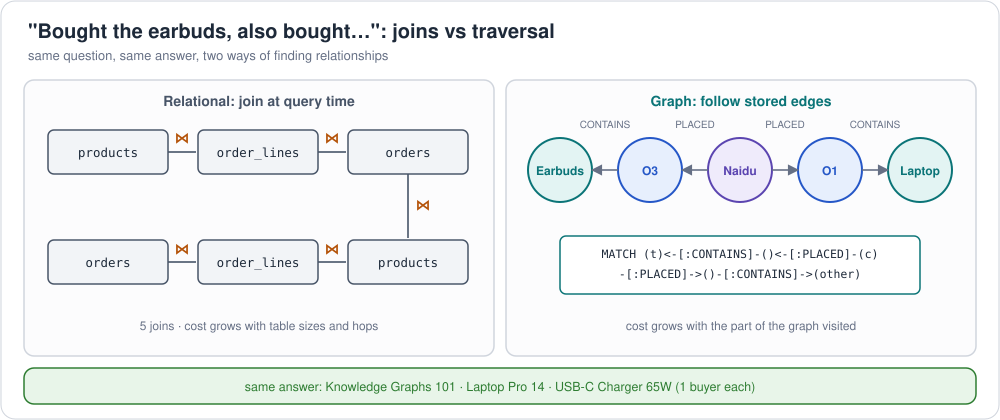

# 4. RDBMS vs graph database, and knowledge graph vs property graph

Two comparisons that come up in every architecture discussion.

## 4.1 Relational database vs graph database



| | Relational (RDBMS) | Graph database |
|---|---|---|
| Data model | tables of rows; relationships are foreign-key values | nodes and edges (property graph) or triples (RDF); relationships are stored data |
| Relationship lookup | **join** at query time (index lookups, hash/merge joins) | **follow** the stored edge (adjacency) |
| Cost of a multi-hop question | grows with each extra join and with table sizes | grows with the part of the graph actually visited |
| Variable depth ("any level", "shortest path") | recursive CTEs; awkward and slow | native: `*0..`, `repeat()`, `{1,5}`, property paths |
| Schema | fixed up front; changes need migrations | flexible: new labels, edge types or properties on the fly (RDF: add triples) |
| Integrity | strong: types, keys, constraints, ACID | varies: ACID in most, constraints weaker (SHACL / DB-specific) |
| Aggregation over many rows | excellent (columnar warehouses especially) | adequate; not their strength |
| Query language | SQL (one standard, everywhere) | Cypher / openCypher, Gremlin, ISO GQL, SPARQL; SQL/PGQ inside SQL |
| Tooling and skills | huge ecosystem | smaller, growing |
| Best at | transactions, reporting, aggregates, well-known fixed relationships | paths, networks, recommendations, fraud rings, lineage, identity resolution, knowledge graphs |

**The retail example in both.** "Customers who bought Wireless Earbuds X also
bought…" needs four joins in SQL:

```sql
SELECT p2.name, COUNT(DISTINCT o1.customer_id) AS buyers
FROM order_lines l1 JOIN orders o1 ON o1.order_id = l1.order_id
JOIN products  p1 ON p1.product_id = l1.product_id AND p1.name = 'Wireless Earbuds X'
JOIN orders    o2 ON o2.customer_id = o1.customer_id
JOIN order_lines l2 ON l2.order_id = o2.order_id
JOIN products  p2 ON p2.product_id = l2.product_id AND p2.product_id <> p1.product_id
GROUP BY p2.name;
```

…and one pattern in a graph:

```cypher
MATCH (t:Product {name:'Wireless Earbuds X'})<-[:CONTAINS]-(:Order)<-[:PLACED]-(c:Customer)
      -[:PLACED]->(:Order)-[:CONTAINS]->(other:Product)
WHERE other <> t
RETURN other.name, count(DISTINCT c) AS buyers
```

"Products under Electronics at any depth" needs a recursive CTE in SQL
([`retail-pgq.sql`](../../examples/retail/property-graph/sql-pgq/retail-pgq.sql))
but is a one-line path in a graph (`-[:SUBCATEGORY_OF*0..]->`).

**It's not either/or.** Typical architecture: the warehouse (RDBMS) stays the
system of record for transactions and metrics; the graph holds the
relationship-heavy view for traversal and AI. **SQL/PGQ**, Spanner Graph,
BigQuery Graph and Fabric Graph blur the line further by declaring graphs
*over* tables, with no copy at all.

## 4.2 Knowledge graph vs property graph

These aren't alternatives at the same level. **Property graph** is a *data
model*; **knowledge graph** is *what the graph is for and how it's
governed*.

| | Property graph (LPG) | Knowledge graph |
|---|---|---|
| What it is | a **data model**: nodes, typed edges, key-value properties | a **graph of real-world entities and facts, organised by an ontology**, with identity and context |
| Defining feature | edges can carry properties; developer-friendly | shared meaning: schema (ontology) + data, often with inference and provenance |
| Data model used | — | **either** RDF **or** a property graph |
| Schema | optional; labels and edge types | central: an ontology (OWL/RDFS, or a governed vocabulary) |
| Identity | local node ids | global, stable identifiers (IRIs), entity resolution across sources |
| Reasoning | usually none (application code) | often: subclass, inverse, transitive, rules |
| Example | the retail graph in Neo4j built from [`01-create-retail-graph.cypher`](../../examples/retail/property-graph/cypher/01-create-retail-graph.cypher) | the retail graph in RDF with [`retail-ontology.ttl`](../../examples/retail/ontology/retail-ontology.ttl), where a reasoner knows Alice is a Customer |

So:

* **Every knowledge graph is a graph, but not every graph is a knowledge
  graph.** A property graph of orders used only by one app, with no shared
  schema or entity identity, is just a graph.
* **A property graph *can* be a knowledge graph** when it's governed by an
  ontology (e.g. imported with Neo4j neosemantics, or modelled from an Ossie
  or Fabric IQ ontology) and used as a shared source of facts.
* **RDF is the "native" KG model** (global IRIs, standard ontologies,
  SPARQL, reasoning), but many production KGs, including large enterprise
  ones, run on property graphs for developer speed and traversal performance.

See [foundations 1](../../foundations/01-ontology-knowledge-graph-graph-database.md)
for the layers (ontology → knowledge graph → data model → database), and
[graphs 1](01-property-graphs.md) for RDF vs property graph in detail.

Next: [graph implementations](../implementations/README.md)
