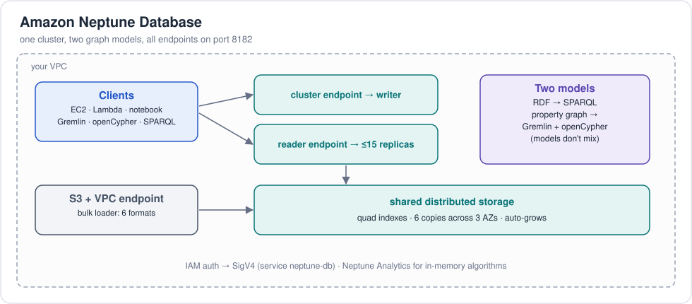

# AWS: graphs

> **Verification:** 🟡 data checked: the Neptune CSVs and RDF files are generated and proven to reproduce the SPARQL answers; the loader script and Python clients were not run against a Neptune cluster. COA is described from its docs only.
> Last reviewed 2026-11-03. Legend: [verification levels](../../../../README.md#verification-levels).

| Product | Role for graphs | Files here |
|---|---|---|
| **Amazon Neptune Database**: RDF + SPARQL | RDF triple store (the knowledge graph) | [`rdf/`](rdf/), [`loading.md`](loading.md), [`querying.md`](querying.md) |
| **Amazon Neptune Database**: property graph | Gremlin + openCypher over one shared graph | [`gremlin-csv/`](gremlin-csv/), [`opencypher-csv/`](opencypher-csv/) |
| **Amazon Neptune Analytics** | in-memory graph analytics, algorithms, vector search | [`loading.md`](loading.md#116-neptune-analytics) |
| **AWS Context Ontology Accelerator (COA)** | builds and serves an ontology-backed knowledge graph in Neptune, plus a virtual knowledge graph over SQL sources | [below](#aws-context-ontology-accelerator-coa-the-knowledge-graph-side) |
| **Bedrock Knowledge Bases** + Neptune Analytics | managed GraphRAG | — |
| Scripts | bulk loader + Python clients (shared with the ontologies topic) | [`bulk-load.sh`](bulk-load.sh), [`python/`](python/) |

AWS also appears in the other topics:
[COA and Neptune for ontologies](../../../../ontologies/implementations/providers/aws/README.md)
(loading OWL, inference without a reasoner) and
[COA metrics and QuickSight](../../../../semantic-models/implementations/providers/aws/README.md).

---

## Amazon Neptune

**Amazon Neptune** is AWS's fully managed graph database service (GA May
2018). It's unusual in supporting **both graph models**:

| Model | Query languages | Bulk-load formats |
|---|---|---|
| Property graph | **Gremlin** (Apache TinkerPop), **openCypher** | `csv` (Gremlin CSV), `opencypher` (openCypher CSV) |
| RDF | **SPARQL 1.1** Query + Update | `turtle`, `ntriples`, `nquads`, `rdfxml` |

> In **Neptune Database** the two models are kept apart: data loaded as RDF
> is only visible to SPARQL; data loaded as property graph is visible to
> **both Gremlin and openCypher** (they share the same graph).

## 10.1 The Neptune family

| | Neptune Database | Neptune Analytics |
|---|---|---|
| Purpose | OLTP: app back-end, high-concurrency reads/writes | OLAP: load big graphs in memory, run algorithms, vector similarity |
| Deployment | Cluster in your VPC: 1 writer + up to 15 read replicas; storage auto-grows, 6 copies across 3 AZs; **Serverless** option; **Global Database** | "Graph" resource sized in memory units (m-NCUs); public or private endpoint |
| Languages | Gremlin, openCypher, SPARQL | openCypher (+ algorithm procedures `neptune.algo.*`) |
| Loading | Bulk loader from S3, or queries | Import from S3 / Neptune DB snapshot / cluster; `CALL neptune.load(...)` batch load |
| Extras | Streams (CDC), full-text search via OpenSearch, ML (Neptune ML / GNNs), IAM auth, audit logs | Graph algorithms (PageRank, Louvain, BFS, ...), **vector search** (embeddings on nodes), GraphRAG |

Related: **Neptune Workbench** (managed Jupyter/SageMaker notebooks with
[graph-notebook](https://github.com/aws/graph-notebook) magics),
**[Graph Explorer](https://github.com/aws/graph-explorer)** (visual
browsing), **Neptune ML**, **Neptune Streams**, and integrations such as
Amazon Bedrock Knowledge Bases (GraphRAG backed by Neptune Analytics) and
LangChain / LlamaIndex graph stores.

## 10.2 Architecture in one picture



Endpoints (all on port **8182**, TLS required):

| Path | Purpose |
|---|---|
| `wss://<endpoint>:8182/gremlin` | Gremlin over WebSocket (drivers, console) |
| `https://<endpoint>:8182/gremlin` | Gremlin over HTTP (`{"gremlin": "..."}`) |
| `https://<endpoint>:8182/openCypher` | openCypher over HTTP (`query=...`) |
| `bolt://<endpoint>:8182` | openCypher over Bolt (Neo4j drivers) |
| `https://<endpoint>:8182/sparql` | SPARQL query/update |
| `https://<endpoint>:8182/loader` | Bulk loader |
| `https://<endpoint>:8182/status` | Engine status / version |
| `.../gremlin/explain`, `/gremlin/profile`, `/openCypher/explain`, SPARQL `explain=` | Query plans |

## 10.3 Getting started (minimal)

1. **Create a cluster** — console *Neptune → Create database* (choose
   Serverless or an instance class like `db.r6g.large`), or IaC
   (CloudFormation / CDK / Terraform `aws_neptune_cluster`).
2. **Network**: Neptune Database lives in private subnets. Connect from
   something in the same VPC (EC2, Cloud9, Lambda, a Neptune notebook) or via
   VPN / SSM port-forwarding / a bastion.
3. **Security**: security group allowing TCP 8182 from your client;
   optionally enable **IAM database authentication** (then every request must
   be SigV4-signed with service name `neptune-db`).
4. **For bulk load**: an **S3 gateway VPC endpoint** and an **IAM role** that
   Neptune can assume with `s3:GetObject` + `s3:ListBucket`, added to the
   cluster.
5. **Create a notebook** (*Neptune → Notebooks*) — fastest way to start.

```bash
# health check
curl https://$NEPTUNE_ENDPOINT:8182/status
```

## 10.4 Neptune and ontologies

Loading the OWL ontology into its own named graph, querying it, and getting
inference without a built-in reasoner are covered in the ontologies topic:
[AWS: ontologies → Neptune as an ontology store](../../../../ontologies/implementations/providers/aws/README.md#amazon-neptune-as-an-ontology-store).

## 10.5 Neptune-specific gotchas

| Topic | Note |
|---|---|
| Gremlin property cardinality | Default is **set** (adding a value appends). Use `property(single, ...)` or `name:String(single)` in CSV headers. |
| Ids | Gremlin/openCypher ids are strings; if you don't supply them Neptune makes UUIDs. Bulk loading requires ids. |
| Lambdas / Groovy scripts | Not supported in Gremlin; use pure traversal steps. |
| Transactions | Each HTTP/script request is a transaction; sessions available for multi-request transactions. |
| Default RDF graph | Triples with no graph go to `http://aws.amazon.com/neptune/vocab/v01/DefaultNamedGraph`; queries by default see the **union** of all graphs. |
| Datatypes | No decimal in property-graph CSV (use Double). RDF keeps `xsd:decimal`. |
| Mixing models | Gremlin + openCypher share data; SPARQL doesn't. Neptune Analytics can import RDF for openCypher querying. |
| Query timeouts | `neptune_query_timeout` parameter (default 120 s); per-query hints exist. |

Docs: [Neptune user guide](https://docs.aws.amazon.com/neptune/latest/userguide/intro.html) ·
[Neptune Analytics guide](https://docs.aws.amazon.com/neptune-analytics/latest/userguide/what-is-neptune-analytics.html) ·
[Neptune data model](https://docs.aws.amazon.com/neptune/latest/userguide/feature-overview-data-model.html) ·
[Best practices](https://docs.aws.amazon.com/neptune/latest/userguide/best-practices.html) ·
[awslabs/amazon-neptune-tools](https://github.com/awslabs/amazon-neptune-tools) (export, CSV↔RDF utilities)

---

## AWS Context Ontology Accelerator (COA): the knowledge-graph side

COA (open source, Apache 2.0; [overview in the ontologies topic](../../../../ontologies/implementations/providers/aws/README.md#aws-context-ontology-accelerator-coa))
uses Neptune as its knowledge-graph store:

| Graph | What COA puts in it |
|---|---|
| **Ontology graph** | the approved OWL ontology (Turtle), materialized in Neptune |
| **Lexical / document graph** | entities and relationships extracted from unstructured documents, linked to the ontology, with OpenSearch Serverless holding the embeddings |
| **Virtual knowledge graph (VKG)** | not stored: **Ontop** rewrites SPARQL into SQL against the live tables using the ontology + **R2RML** mappings that induction generated |

The VKG is the graph equivalent of a semantic layer: the data stays in the
warehouse, the ontology gives it graph shape, and SPARQL queries run against
SQL sources. For the retail example that means asking SPARQL over
[`warehouse/`](../../../../examples/retail/warehouse/) tables without loading
any RDF; the mapping job is the same one [Ossie's mapping](../../../../examples/retail/semantic-model/ossie/retail.mapping.yaml)
and R2RML do.

Agents reach the graph through COA's MCP tools `graph_traversal` (walk
entity relationships), `translate_sparql` (natural language → SPARQL) and
`query`. Note the cost: COA's docs put the idle cost of Neptune plus
OpenSearch Serverless at about $930/month.

Next: [Loading the retail example into Neptune](loading.md)
