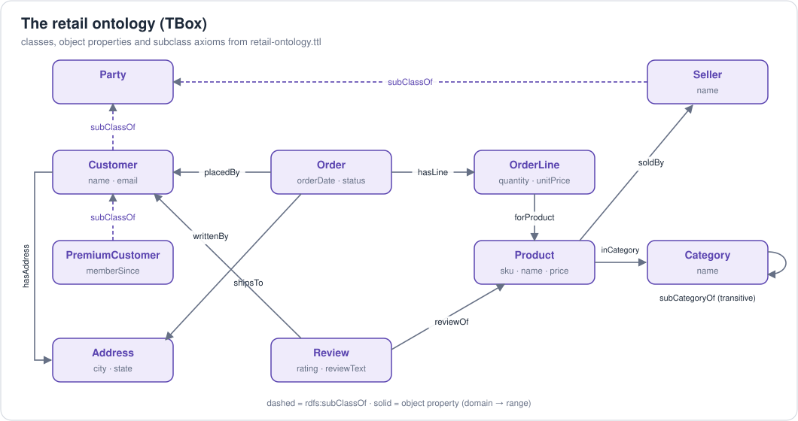
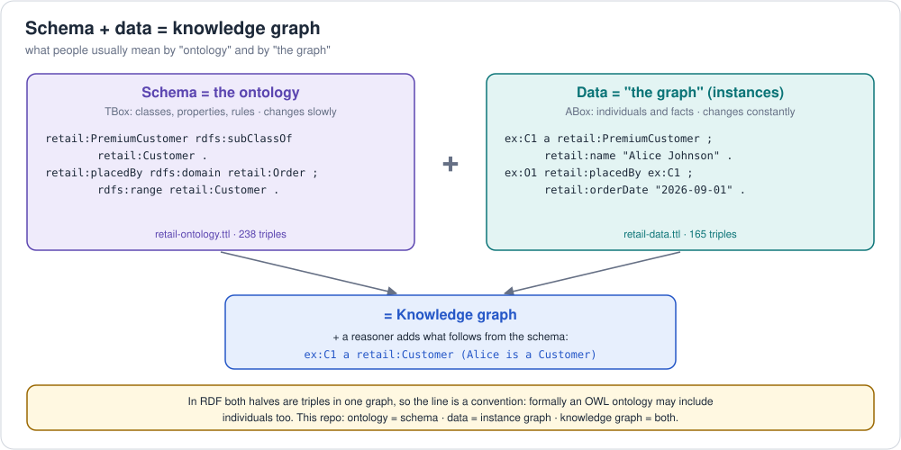

# 1. What is an ontology?

> "An ontology is an explicit specification of a conceptualization."
> — Tom Gruber, 1993

> "...a **formal**, explicit specification of a **shared** conceptualization."
> — Studer, Benjamins & Fensel, 1998 (the definition most people quote today)

Put simply: **an ontology is a machine-readable agreement about what things
exist in a domain, what they are called, how they relate, and which rules
always hold.**

| Word in the definition | What it means in practice |
|---|---|
| *conceptualization* | A model of a slice of the world: customers, orders, products |
| *explicit* | Written down, not tribal knowledge in someone's head or code |
| *formal* | In a language with defined semantics (OWL, RDFS) so a machine can reason with it |
| *shared* | Agreed by a community/team, so data from different systems lines up |

## The building blocks

Using the retail example in this repo
([`retail-ontology.ttl`](../../examples/retail/ontology/retail-ontology.ttl)):

| Building block | Also called | Retail example |
|---|---|---|
| **Class** | concept, type, category | `Customer`, `Order`, `Product` |
| **Subclass** (is-a hierarchy) | taxonomy | `PremiumCustomer ⊑ Customer` |
| **Individual** | instance, entity | `ex:C1` (Alice), `ex:P1` (Laptop Pro 14) |
| **Object property** | relation, role | `placedBy` (Order → Customer) |
| **Datatype property** | attribute | `price` (Product → xsd:decimal) |
| **Domain / range** | signature | `placedBy` has domain `Order`, range `Customer` |
| **Axiom** | rule, constraint | "every Order is placedBy exactly 1 Customer" |
| **Property characteristics** | | `subCategoryOf` is *transitive*; `placedBy` is *functional*; `placedBy` is the *inverse* of `placedOrder` |
| **Annotation** | metadata | `rdfs:label`, `skos:definition`, `dcterms:creator` |

### TBox vs ABox

Description logic, the logic underneath OWL, splits a knowledge base into
parts named after what they hold:

* **TBox**, where **T = terminological**: the *terminology*, meaning classes,
  properties and axioms. This is *the schema*.
  → `ontology/retail-ontology.ttl` (e.g. `PremiumCustomer ⊑ Customer`)
* **ABox**, where **A = assertional**: *assertions* about specific
  individuals. This is *the data*.
  → `rdf/retail-data.ttl`. Two kinds:
  * **class assertions**: what type something is (`Alice : PremiumCustomer`);
  * **role (property) assertions**: how things relate or what value they
    have (`placedBy(O1, Alice)`, `name(Alice, "Alice Johnson")`).
* **RBox**, where **R = role**, sometimes listed separately: axioms about the
  properties themselves (`subCategoryOf` is transitive, `placedOrder` is the
  inverse of `placedBy`). Many texts fold it into the TBox.

Ontology + data (+ often a reasoner) = **knowledge graph**.

In everyday use, **"ontology" means the schema** and the data is called
**"the graph"** or instance data. Formally an OWL ontology may include
individuals too, so some people use "ontology" for schema + data. See
[schema vs data](../../foundations/01-ontology-knowledge-graph-graph-database.md#schema-vs-data-what-ontology-and-the-graph-usually-mean)
for when each usage applies.

## What an ontology buys you

1. **Shared vocabulary.** "customer", "client", "buyer" and "account holder"
   collapse to one IRI: `https://example.org/retail/ontology#Customer`.
2. **Integration.** Two systems that map to the same ontology can be merged by
   simply loading both datasets into one graph (IRIs are global identifiers).
3. **Inference.** New facts follow from rules. From the retail data:
   * Alice is typed only `PremiumCustomer` → a reasoner knows she is a
     `Customer`, a `Party` and a `schema:Person`.
   * `Laptops subCategoryOf Computers subCategoryOf Electronics` → laptops are
     Electronics (transitivity).
   * Order `placedBy` Alice → Alice `placedOrder` the order (inverse).
   * Alice placedOrder O1, O1 hasLine L1, L1 forProduct P1 → Alice
     `purchased` P1 (property chain).
4. **Consistency checking.** If something were both an `Order` and a
   `Product`, the reasoner flags it (the classes are declared disjoint).
5. **Self-describing data.** The schema lives *in* the graph and can be
   queried like data (see [`01-list-classes-and-properties.rq`](../../examples/retail/sparql/01-list-classes-and-properties.rq)).
6. **Grounding for AI.** LLM apps use ontologies/knowledge graphs to
   constrain extraction, to answer with facts instead of guesses (GraphRAG), and
   to explain answers by path.

## Open world vs closed world (the #1 surprise)

OWL uses the **Open World Assumption**: if a fact is missing, it is *unknown*,
not *false*.

* Ontology says "every Order has ≥1 OrderLine". You add an order with no lines.
  A database would reject it. An OWL reasoner says: *fine, the line exists, we
  just don't know it yet.*
* OWL has **no Unique Name Assumption**: `ex:C1` and `ex:customer-1` could be
  the same person unless you say `owl:differentFrom` (or the opposite,
  `owl:sameAs`).

For "data must look like X" checks, use **SHACL** (closed-world validation) —
see [`retail-shapes.ttl`](../../examples/retail/ontology/retail-shapes.ttl) and
[chapter 2](02-documenting-ontologies.md).

## Kinds of ontologies (and things that are *almost* ontologies)

From least to most formal — the "ontology spectrum":

| Artifact | Example | Has hierarchy? | Has formal rules? |
|---|---|---|---|
| Controlled vocabulary / glossary | list of order statuses | no | no |
| Taxonomy | product category tree | yes (broader/narrower) | no |
| Thesaurus | SKOS concept scheme with synonyms, related terms | yes | minimal |
| Schema / data model | ER diagram, JSON Schema, GQL graph type | partly | structural only |
| Lightweight ontology | schema.org, RDFS vocabularies | yes | domain/range |
| Heavyweight ontology | OWL 2 DL with restrictions, SNOMED CT | yes | full logic |

By scope:

* **Upper / foundational** ontologies: very general categories (object,
  process, quality). *BFO* (ISO/IEC 21838-2), *DOLCE*, *SUMO*, *gist*.
* **Domain** ontologies: one field. *FIBO* (finance), *SNOMED CT* (clinical),
  *Gene Ontology*, *GoodRelations* (e-commerce, now part of schema.org).
* **Application** ontologies: one system — like the retail ontology here.

**Reuse before you invent.** The retail ontology aligns to schema.org
(`retail:Product owl:equivalentClass schema:Product`), so any tool that
understands schema.org understands our products.

## Ontology vs ...

| | Ontology | Relational schema | Taxonomy |
|---|---|---|---|
| Purpose | meaning + reasoning | storage + integrity | navigation / classification |
| World assumption | open | closed | n/a |
| Identifiers | global IRIs | local keys | labels/codes |
| Multiple inheritance | yes | awkward | sometimes |
| Schema changes | add triples | migrations | re-tree |
| Rules | logical axioms → inference | constraints → rejection | none |

Next: [2. Documenting (writing down) an ontology](02-documenting-ontologies.md) · coming from programming? [5. Ontologies for software engineers](05-ontology-for-software-engineers.md)
