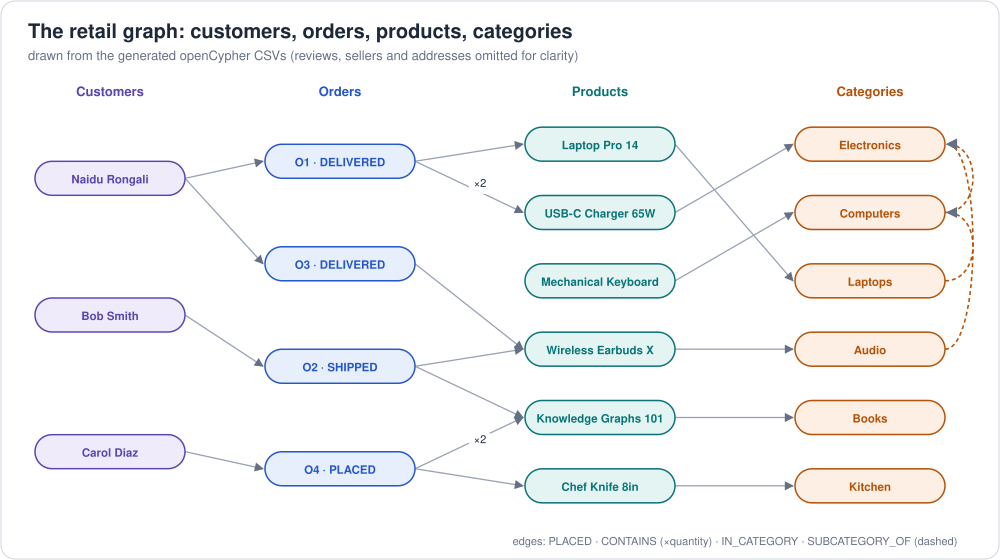

# 4. The retail ordering example, end to end

An online marketplace (Amazon-style): **customers** place **orders**;
each order has **order lines** (product × quantity × price paid); **products**
sit in a **category** tree and are **sold by** sellers; customers write
**reviews**; orders **ship to** an **address**.

All names (TechHub Inc, Alice Johnson, ...) are made up.

## 4.1 The domain in one picture (instance data)



Plus: 3 sellers (TechHub Inc sells all electronics, PageTurner Books, HomeGoods
Co), 3 addresses (Seattle, Austin, New York), 4 reviews (Alice → Laptop 5★,
Alice → Earbuds 3★, Bob → Book 4★, Carol → Book 5★).

## 4.2 Files

```
examples/retail/
├── ontology/
│   ├── retail-ontology.ttl      OWL 2 ontology (TBox)  ← start here
│   ├── retail-ontology.nt       same, N-Triples (generated)
│   └── retail-shapes.ttl        SHACL validation shapes
├── rdf/                          instance data (ABox)
│   ├── retail-data.ttl          Turtle  ← source of truth
│   ├── retail-data.nt           N-Triples        ┐
│   ├── retail-data.nq           N-Quads (4 named graphs)
│   ├── retail-data.trig         TriG (4 named graphs)  generated by
│   ├── retail-data.rdf          RDF/XML          │ build_rdf_formats.py
│   └── retail-data.jsonld       JSON-LD          ┘
├── sparql/                      13 SPARQL queries / updates
├── property-graph/
│   ├── cypher/                  openCypher create script + queries
│   ├── gremlin/                 Gremlin create script + traversals
│   ├── gql/                     ISO GQL version
│   └── sql-pgq/                 SQL/PGQ version (graph view over tables)
├── warehouse/                   star schema for semantic layers (schema.sql, data/*.csv, metrics.sql)
├── semantic-model/ossie/        Apache Ossie semantic model + ontology + mapping
└── scripts/
    ├── build_rdf_formats.py     Turtle → nt, nq, trig, rdf, jsonld
    ├── rdf_to_property_graph.py RDF → property graph (Neptune CSVs, Cypher, Gremlin)
    ├── rdf_to_tables.py         RDF → warehouse tables
    ├── run_sparql_local.py      run all SPARQL in memory (+ --reason, --shacl)
    ├── check_consistency.py     proves all graph formats contain the same data
    └── check_semantic_model.py  proves warehouse + Ossie metrics = SPARQL answers

graphs/implementations/providers/aws/   Neptune bulk-load CSVs + RDF, bulk-load.sh, Python clients
                                 (generated by rdf_to_property_graph.py / build_rdf_formats.py)
```

```bash
cd examples/retail
pip install rdflib pyshacl owlrl
python scripts/build_rdf_formats.py
python scripts/rdf_to_property_graph.py
python scripts/run_sparql_local.py --shacl
python scripts/check_consistency.py
```

## 4.3 Modelling decisions worth noticing

| Decision | Why |
|---|---|
| `OrderLine` is a class | RDF triples can't carry attributes, so quantity & price-paid need their own node (n-ary relation pattern). In the property graph it becomes an **edge with properties**. |
| `unitPrice` on the line *and* `price` on the product | The price paid is a historical fact; list price changes (see O3, a sale). |
| Only `placedBy` is stated; `placedOrder` is its `owl:inverseOf` | State each fact once; let inference / inverse paths (`^retail:placedBy`) give you the other direction. |
| `subCategoryOf` is `owl:TransitiveProperty` and a sub-property of `skos:broader` | Hierarchy queries at any depth; SKOS tools understand the tree. |
| `purchased` via `owl:propertyChainAxiom` | A shortcut relation derived from Customer→Order→Line→Product. |
| `PremiumCustomer ⊑ Customer` | Specialisation without duplicating properties. In the property graph it became `premium: true` (could also be a 2nd label). |
| Alignment with schema.org | `retail:Product ≡ schema:Product`, `retail:Customer ⊑ schema:Person` — instant interoperability with web data. |
| Separate TBox / ABox / shapes | Ontology changes slowly, data changes constantly, validation rules vary by consumer. |
| IRIs under `https://example.org/retail/` | Replace with a domain you control (or `https://w3id.org/...`) in real life. |

## 4.4 Competency questions → queries in every language

| # | Question | Expected answer | SPARQL | Cypher | Gremlin |
|---|---|---|---|---|---|
| Q2 | Products under Electronics, any depth | Laptop Pro 14, Mechanical Keyboard, USB-C Charger 65W, Wireless Earbuds X | [02](../../examples/retail/sparql/02-electronics-products-incl-subcategories.rq) | [Q2](../../examples/retail/property-graph/cypher/02-queries.cypher) | [Q2](../../examples/retail/property-graph/gremlin/02-queries.groovy) |
| Q3 | Spend per customer | Alice 1498.97 (2 orders) · Bob 199.98 · Carol 179.48 | [03](../../examples/retail/sparql/03-order-totals-per-customer.rq) | Q3 | Q3 |
| Q4 | Details of order O1 | Laptop 1×1299.00, Charger 2×29.99 → Seattle | [04](../../examples/retail/sparql/04-order-details.rq) | Q4 | Q4 |
| Q5 | Bought Earbuds, also bought | Knowledge Graphs 101, Laptop Pro 14, USB-C Charger 65W | [05](../../examples/retail/sparql/05-customers-who-bought-also-bought.rq) | Q5 | Q5 |
| Q6 | Average rating per product | Laptop 5 · Book 4.5 (2) · Earbuds 3 | [06](../../examples/retail/sparql/06-average-rating-per-product.rq) | Q6 | Q6 |
| Q7 | Products never ordered | Mechanical Keyboard | [07](../../examples/retail/sparql/07-products-never-ordered.rq) | Q7 | Q7 |
| Q8 | All customers incl. subclasses (RDF) / path Alice→Carol (PG) | Alice, Bob, Carol / Alice→O3→Earbuds→O2→Bob→O2→Book→O4→Carol | [08](../../examples/retail/sparql/08-all-customers-via-subclass.rq) | Q8 | Q8 |
| W1 | Bob orders a keyboard | +1 order | [12](../../examples/retail/sparql/12-insert-new-order.ru) | W1 | W1 |
| W2 | Shipped → delivered | O2 updated | [13](../../examples/retail/sparql/13-update-status.ru) | W2 | W2 |

Also in [GQL](../../examples/retail/property-graph/gql/queries.gql) and
[SQL/PGQ](../../examples/retail/property-graph/sql-pgq/retail-pgq.sql).

## 4.5 Extending the example (exercises)

1. Add a `Shipment` class with `carrier` and `deliveredOn`, and a SHACL rule
   that DELIVERED orders must have a shipment.
2. Add `Brand` and make "customers who like brand X" a query.
3. Add `wishlist` edges and write "products on wishlists but never bought".
4. Make the category tree a SKOS `ConceptScheme` with `prefLabel`s in two
   languages and query by language tag (`FILTER(lang(?l) = "es")`).
5. Load the data into Neptune both ways (RDF and property graph) and compare
   query plans ([Neptune loading](../../graphs/implementations/providers/aws/loading.md)).

Next: [5. Ontologies for software engineers: from OOP to OWL](05-ontology-for-software-engineers.md)
