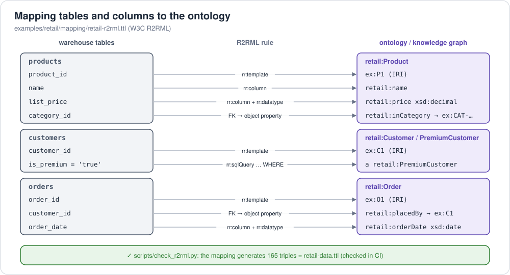

# 7. Mapping an ontology to physical tables and columns

Most enterprise data lives in tables with names like `TBL_CUST.C_ADR_1`,
not in RDF. A **mapping** says which tables and columns hold which
ontology classes and properties, and so connects the meaning (ontology) to
the data (warehouse). Every approach below answers the same three questions:

1. **Which rows are instances of which class?** (`orders` rows → `retail:Order`)
2. **How does a row's key become a global identifier (IRI)?** (`O1` → `https://example.org/retail/data/O1`)
3. **Which column or join is which property?** (`orders.customer_id` → `retail:placedBy`)



## 7.1 Five approaches

| Approach | Mechanism | Best for | Typical tooling |
|---|---|---|---|
| **1. Declarative W3C mappings** | mapping files (Turtle) from tables/files to RDF | open, vendor-neutral pipelines | **R2RML**, **RML**, xR2RML, W3C Direct Mapping |
| **2. Virtualization (OBDA)** | the mapping lives in an engine that rewrites SPARQL to SQL at query time | live queries over existing databases, no copy | **Ontop**, **Stardog** (SMS2 / R2RML), AWS COA's VKG |
| **3. Code and materialization** | scripts or a raw dump + SPARQL `CONSTRUCT` produce RDF in batch | bulk loads, offline knowledge graphs | rdflib, Apache Jena, Spark, SPARQL CONSTRUCT |
| **4. LLM-assisted matching** | lexical + structural + LLM matching proposes column → property links | large or poorly documented schemas | LogMap (incl. LLM variant), Agent-OM, custom LLM pipelines |
| **5. AI-assisted with governance** | LLM-induced mappings + human approval, stored in open standards and served to agents | production AI agents needing auditable data access | **AWS COA**; OntoBricks (Databricks Labs) |

Semantic layers solve a related but different problem: **semantic views**
(Snowflake), metric views (Databricks) and Ossie *mappings* bind business
names to tables **without producing RDF**; see 7.6.

## 7.2 Approach 1: R2RML and RML (verified on the retail data)

**R2RML** (W3C Recommendation, 2012) maps relational tables or SQL queries
to RDF. **RML** extends the same model to CSV, JSON and XML sources.
**xR2RML** extends it to NoSQL sources like MongoDB. The W3C **Direct
Mapping** is the zero-configuration variant: every table becomes a class,
every column a property.

The retail mapping, [`retail-r2rml.ttl`](../../examples/retail/mapping/retail-r2rml.ttl),
maps the eight warehouse tables back onto the ontology:

```turtle
map:Product a rr:TriplesMap ;
    rr:logicalTable [ rr:tableName "products" ] ;                         # 1. which rows
    rr:subjectMap [ rr:template "https://example.org/retail/data/{product_id}" ;  # 2. key → IRI
                    rr:class retail:Product ] ;
    rr:predicateObjectMap [ rr:predicate retail:price ;                   # 3. column → property
        rr:objectMap [ rr:column "list_price" ; rr:datatype xsd:decimal ] ] ;
    rr:predicateObjectMap [ rr:predicate retail:inCategory ;              #    FK → object property
        rr:objectMap [ rr:template "https://example.org/retail/data/{category_id}" ; rr:termType rr:IRI ] ] .
```

Running it with Morph-KGC (an open-source R2RML/RML engine) **reproduces
`retail-data.ttl` exactly**, checked in CI:

```text
$ python scripts/check_r2rml.py
ok  R2RML mapping              165 triples from the warehouse tables = retail-data.ttl (165 triples)
```

That closes a loop: RDF → tables ([`rdf_to_tables.py`](../../examples/retail/scripts/rdf_to_tables.py)) → RDF (R2RML) returns the original knowledge graph.

**Mapping problems the retail example shows:**

| Problem | Table side | Ontology side | How the mapping handles it |
|---|---|---|---|
| name mismatch | `products.list_price` | `retail:price` | explicit `rr:column` → `rr:predicate` |
| subclass stored as a flag | `customers.is_premium = 'true'` | `retail:PremiumCustomer` | two TriplesMaps over `rr:sqlQuery … WHERE is_premium = …` |
| reversed direction | FK `order_lines.order_id` | `Order retail:hasLine OrderLine` | a TriplesMap on `order_lines` whose *subject* is the order |
| recursive hierarchy | `categories.parent_category_id` | `retail:subCategoryOf` (transitive) | IRI template on the parent column; NULL → no triple |
| datatypes | `DECIMAL`, `DATE`, `INTEGER` | `xsd:decimal`, `xsd:date`, `xsd:positiveInteger` | `rr:datatype` |
| identifiers | local keys `C1`, `O1` | global IRIs | `rr:template` |

## 7.3 Approach 2: virtual knowledge graphs (OBDA)

Ontology-Based Data Access keeps the data in the database. The engine holds
the ontology and mapping, and **rewrites each SPARQL query into SQL** at
query time.

* **Ontop**: open source; R2RML or its own mapping syntax; used inside AWS
  COA as the "VKG" tier.
* **Stardog** virtual graphs: R2RML or **SMS2** (Stardog Mapping Syntax 2),
  which is loosely based on SPARQL CONSTRUCT and also covers JSON and CSV
  sources.
* Trade-off: always-fresh data and no copy, but query performance depends
  on the SQL that gets generated, and reasoning is limited to what can be
  rewritten (OWL 2 QL).

## 7.4 Approach 3: code and materialization

* **Scripted ETL**: read tables (JDBC, a catalog, files), emit triples with
  rdflib or Jena, and write Turtle or N-Triples for a bulk loader. Flexible
  and easy to debug, but the mapping logic is buried in code.
* **Direct mapping + CONSTRUCT**: dump tables 1:1 as "raw" RDF (W3C Direct
  Mapping), then rewrite into the target ontology with SPARQL:

  ```sparql
  # schematic: Direct Mapping names predicates like <base/orders#customer_id>
  CONSTRUCT { ?o a retail:Order ; retail:placedBy ?c . }
  WHERE { ?row <orders#order_id> ?oid ; <orders#customer_id> ?cid .
          BIND(IRI(CONCAT(STR(ex:), ?oid)) AS ?o) BIND(IRI(CONCAT(STR(ex:), ?cid)) AS ?c) }
  ```

  The rewrite stays in standard SPARQL and can be versioned and tested like
  any query.

## 7.5 Approach 4: LLM-assisted schema matching

Matching hundreds of cryptic columns to ontology terms is slow by hand.
Current practice combines three signals and uses the LLM for the hard cases:

1. **lexical**: names, abbreviations, synonyms (`C_ADR_1` ~ address line 1);
2. **structural**: keys, foreign-key paths and value patterns constrain what
   can match;
3. **LLM**: an agent judges ambiguous candidates using descriptions and
   sample values.

Examples: **LogMap** (classic ontology matcher, with an LLM-assisted
variant reported in recent evaluations) and **Agent-OM** (LLM agents for
ontology matching, VLDB 2025). Treat LLM output as **proposals**: keep a
human review step, and test the result (as `check_r2rml.py` does) before
serving it.

## 7.6 Approach 5: AI-assisted with governance (AWS COA)

[AWS Context Ontology Accelerator](../implementations/providers/aws/README.md#aws-context-ontology-accelerator-coa)
packages the approaches above into one workflow:

1. **Scan**: connect sources, discover schemas and metadata.
2. **Model**: an LLM **induces an OWL ontology plus R2RML mappings**,
   grounded in existing ontologies (FIBO, schema.org). Domain experts
   **review, edit and approve** them before anything is served.
3. **Serve**: approved mappings power a **virtual knowledge graph** (Ontop)
   and agents query through MCP. Generated SQL passes a SQL firewall, so
   agents use **human-approved joins and definitions** instead of improvising
   them. This greatly reduces invented joins, though, like any LLM system,
   it doesn't make prompt injection impossible.

Databricks' **OntoBricks** follows a similar pattern (OWL design, LLM-assisted
R2RML mapping, OWL 2 RL/SHACL reasoning, SPARQL and MCP).

**Mappings in semantic layers.** An Apache Ossie
[mapping document](../../examples/retail/semantic-model/ossie/retail.mapping.yaml)
links semantic-model fields to ontology concepts. Snowflake semantic views
and Databricks metric views bind business names, relationships and metrics
to tables using **SQL expressions** (Power BI uses DAX). None of these
produce RDF: they're the semantic-layer counterpart to R2RML.

## 7.7 Choosing an approach

| If you need… | Use |
|---|---|
| a portable, standard mapping you can test | R2RML / RML (+ Morph-KGC, RMLMapper) |
| live SPARQL over operational databases, no copy | OBDA: Ontop, Stardog virtual graphs |
| a big, fast, offline knowledge graph | materialize with R2RML or code, bulk-load (e.g. Neptune) |
| to map a huge legacy schema | LLM-assisted matching, then human review, then R2RML |
| governed context for AI agents | AWS COA / OntoBricks (OWL + R2RML), NVIDIA Auto Ontology (terms mapped to columns, not OWL), or your own: ontology + R2RML + approval + VKG |
| BI metrics, not a knowledge graph | a semantic layer (Ossie, dbt, semantic views), [semantic models](../../semantic-models/README.md) |

Next: [ontology implementations](../implementations/README.md) · or
[foundations 4: what a data agent needs](../../foundations/04-data-agents.md)
