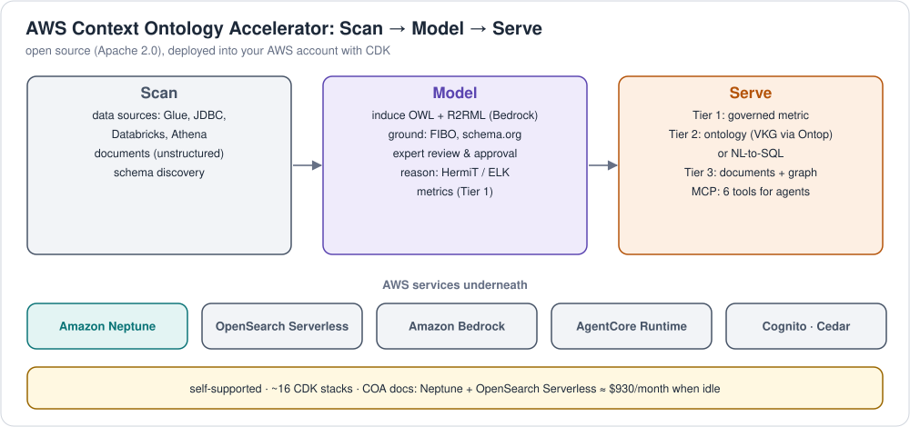

# AWS: ontologies

> **Verification:** ⚪ documented. The RDF/OWL files loaded here are 🟡 checked (generated and proven consistent), but nothing was run against Neptune or a COA deployment.
> Last reviewed 2026-11-03. Legend: [verification levels](../../../../README.md#verification-levels).

| Product | Role for ontologies | Retail example |
|---|---|---|
| **AWS Context Ontology Accelerator (COA)** | Open-source (Apache 2.0) ontology layer for AI agents: induce an OWL ontology from your data with an LLM, ground it in existing ontologies, have experts approve it, reason over it, serve it to agents via MCP | upload [`retail-ontology.ttl`](../../../../examples/retail/ontology/retail-ontology.ttl), below |
| **Amazon Neptune** (Database) | RDF store for the ontology (TBox) and the instance data (ABox); SPARQL 1.1 | [load + query the ontology](#amazon-neptune-as-an-ontology-store) |

AWS also appears in the other topics: [Neptune as a graph database](../../../../graphs/implementations/providers/aws/README.md) and [COA's metrics and QuickSight](../../../../semantic-models/implementations/providers/aws/README.md).

---

## AWS Context Ontology Accelerator (COA)

**What it is:** an open-source **semantic context layer** that combines
knowledge graphs, formal ontologies and rules with LLMs, so AI agents
retrieve context, check it against business logic, and act consistently and
explainably. Announced July 2026; Apache 2.0; repository
[aws/context-ontology-accelerator](https://github.com/aws/context-ontology-accelerator)
(release `v0.3.8` reviewed here); docs
[aws.github.io/context-ontology-accelerator](https://aws.github.io/context-ontology-accelerator/).
AWS says the managed ontology capability will become a native feature of
**AWS Context**; COA is the self-deployed path.

### How it maps to the ontology concepts

| Concept ([ontologies/concepts](../../../concepts/)) | In COA |
|---|---|
| Ontology language | **OWL, stored as Turtle**, materialized in Neptune |
| Writing the ontology | **Induction**: Bedrock (Claude) reads table schemas or documents and drafts classes, properties and relationships, plus **R2RML** mappings from tables to the ontology. Or **upload** Turtle, RDF/XML, OWL/XML or JSON-LD |
| Reuse / alignment | **Grounding** against foundational ontologies (e.g. FIBO, schema.org) or earlier accepted ontologies, emitting `rdfs:subClassOf` / `skos:*Match` links (`groundingMode`: `NONE`, `STANDARD`, `ENHANCED`) |
| Human review | Induced ontologies arrive as **proposals** that domain experts edit and approve before agents use them |
| Reasoning | Ontology engine with **HermiT** and **ELK** OWL reasoners (unlike plain Neptune, which has none) |
| Governance | **Namespaces** with roles (owner, maintainer, data-steward, data-analyst), Cedar policies |
| Serving | MCP tools `describe_schema`, `translate_sparql`, `graph_traversal`, plus `query` |

### Workflow: Scan → Model → Serve



### The retail ontology in COA

1. Create a namespace, e.g. `retail`.
2. **Upload** [`retail-ontology.ttl`](../../../../examples/retail/ontology/retail-ontology.ttl)
   (OWL 2 in Turtle, no conversion needed). It already aligns to schema.org
   (`retail:Product owl:equivalentClass schema:Product`), which is the same
   alignment COA's grounding would propose.
3. Or register the warehouse tables ([`schema.sql`](../../../../examples/retail/warehouse/schema.sql))
   as a data source and run **induction**. Comparing the induced ontology with the
   hand-written one is a good exercise: does it find `OrderLine`, the
   category hierarchy, and `PremiumCustomer`?
4. Agents then ask e.g. *"which customers bought products in Electronics?"*, and
   COA answers through the ontology (Tier 2) instead of guessing joins.

### Things to know

* **Cost:** COA's own docs warn that Neptune plus OpenSearch Serverless cost
  about **$930/month when idle**; it deploys around 16 CDK stacks.
* **Self-supported:** it's open source you deploy and run. The repository is
  a read-only mirror (issues welcome, no pull requests); AWS recommends
  starting from a tagged release, not `main`.
* **Not verified here:** this repo has no COA deployment; the mapping above
  comes from COA's documentation and API models (v0.3.8).

---

## Amazon Neptune as an ontology store

Neptune stores OWL ontologies as ordinary RDF triples and answers SPARQL
over them. It does **not** run an OWL/RDFS reasoner.

### Load

Put the ontology and the data in separate **named graphs**, so the ontology
can be replaced on its own:

| Named graph | File |
|---|---|
| `https://example.org/retail/graph/ontology` | [`retail-ontology.ttl`](../../../../graphs/implementations/providers/aws/rdf/retail-ontology.ttl) |
| `https://example.org/retail/graph/data` | [`retail-data.ttl`](../../../../graphs/implementations/providers/aws/rdf/retail-data.ttl) |

The bulk-load commands (S3, IAM role, `parserConfiguration.namedGraphUri`)
are in [Neptune loading](../../../../graphs/implementations/providers/aws/loading.md#113-formats-cf--rdf),
and the script is [`bulk-load.sh`](../../../../graphs/implementations/providers/aws/bulk-load.sh).
These files are shared with the graphs topic, so there's one copy to maintain.

### Query the ontology

```sparql
# Every class and its superclasses (the schema is data too)
PREFIX owl:  <http://www.w3.org/2002/07/owl#>
PREFIX rdfs: <http://www.w3.org/2000/01/rdf-schema#>
SELECT ?class ?super WHERE {
  GRAPH <https://example.org/retail/graph/ontology> {
    ?class a owl:Class . OPTIONAL { ?class rdfs:subClassOf ?super }
  }
}
```

More: [`01-list-classes-and-properties.rq`](../../../../examples/retail/sparql/01-list-classes-and-properties.rq),
run with [`sparql_query.py`](../../../../graphs/implementations/providers/aws/python/sparql_query.py).

### Inference without a reasoner

Neptune's default dataset is the union of all named graphs, so data queries
can use the ontology directly:

1. **Query-time paths:** `?c rdf:type/rdfs:subClassOf* retail:Customer` finds
   PremiumCustomers too ([`08-all-customers-via-subclass.rq`](../../../../examples/retail/sparql/08-all-customers-via-subclass.rq)).
2. **Materialize with SPARQL UPDATE:** turn rules into `INSERT … WHERE`
   (e.g. the `purchased` property chain from [`09-construct-purchased.rq`](../../../../examples/retail/sparql/09-construct-purchased.rq)).
3. **Reason before loading:** run OWL RL offline (`python scripts/run_sparql_local.py --reason`
   grows 403 → 1187 triples) and load the result.
4. **Use COA**, which adds HermiT/ELK reasoning on top of Neptune.

Validate with SHACL ([`retail-shapes.ttl`](../../../../examples/retail/ontology/retail-shapes.ttl))
before loading. Neptune doesn't validate SHACL either.

Docs: [Neptune SPARQL](https://docs.aws.amazon.com/neptune/latest/userguide/access-graph-sparql.html) ·
[COA](https://aws.github.io/context-ontology-accelerator/) ·
[COA announcement](https://aws.amazon.com/about-aws/whats-new/2026/07/aws-context--ontology-accelarator-generally-available/)
