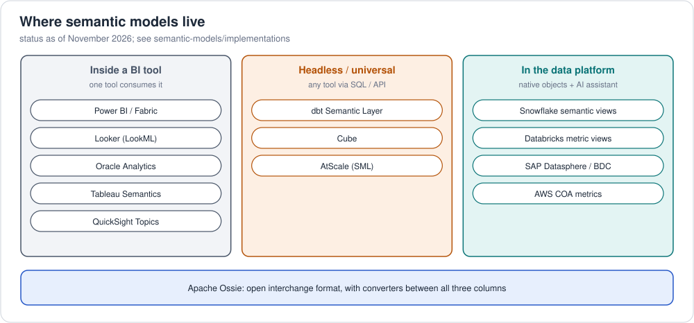

# 2. How reporting tools do semantic modelling

Every serious BI tool has a semantic model; they differ in **where it
lives**, **what language** defines it, and **who else can use it**.

## 2.1 Three generations



## 2.2 BI tools

| Tool | Semantic model | Definition language | Query language | Model as code? |
|---|---|---|---|---|
| **Microsoft Power BI / Fabric** | Semantic model (formerly "dataset"); VertiPaq in-memory or DirectQuery / Direct Lake | **TMDL** (text) or TMSL/BIM (JSON); Power Query **M** for loading | **DAX** (also MDX for Excel) | Yes: TMDL + PBIP projects in git |
| **Google Looker** | LookML project: views, explores, models | **LookML** | generates SQL; Looker API; Open SQL Interface | Yes (git-native since 2012) |
| **Tableau** | Data sources with logical relationships; **Tableau Semantics** (Tableau Next / Salesforce Data Cloud) | Tableau UI / XML (`.tds`); Semantics in Data Cloud | VizQL; Tableau Semantics API | Partly |
| **Qlik Sense** | Associative data model + master items | Load script | Qlik expressions (set analysis) | Partly |
| **MicroStrategy (Strategy)** | Schema objects (attributes, facts, metrics); **Mosaic** universal semantic layer | MicroStrategy objects | generates SQL | Partly |
| **SAP BusinessObjects / Datasphere** | Universes (.unx); Datasphere analytic models | Information Design Tool / Datasphere | generates SQL | No |
| **ThoughtSpot** | Models / Worksheets | **TML** (YAML) | search tokens; generates SQL | Yes |
| **Sigma, Omni, Hex, Lightdash, Holistics** | Data models / topics | YAML (Omni, Lightdash), AML (Holistics) | generate SQL | Yes |
| **Amazon QuickSight** | Datasets + **Topics** (natural-language layer for Q) | UI / API | generates SQL | API |
| **Oracle Analytics** | Semantic model (RPD) | Semantic Modeler / SMML (JSON) | Logical SQL | Yes (SMML in git) |

### What the retail model looks like in each

| Tool | File in this repo |
|---|---|
| Power BI (TMDL + DAX) | [`implementations/providers/microsoft/power-bi/`](../implementations/providers/microsoft/power-bi/Retail.SemanticModel/definition/) |
| Looker (LookML) | [`implementations/providers/gcp/looker/`](../implementations/providers/gcp/looker/) |
| dbt MetricFlow ✅ *executed* | [`implementations/tools/dbt/retail_dbt/`](../implementations/tools/dbt/retail_dbt/) |
| Cube | [`implementations/tools/cube/model/`](../implementations/tools/cube/model/) |
| AtScale SML | [`implementations/tools/atscale/sml/`](../implementations/tools/atscale/sml/) |
| Snowflake semantic view | [`implementations/providers/snowflake/`](../implementations/providers/snowflake/) |
| Databricks metric view | [`implementations/providers/databricks/`](../implementations/providers/databricks/) |
| Apache Ossie (open) ✅ *validated* | [`examples/retail/semantic-model/ossie/`](../../examples/retail/semantic-model/ossie/) |

## 2.3 The same metric, eight ways

*Average order value = revenue / number of orders.*

| Format | Definition |
|---|---|
| Plain SQL | `SUM(quantity * unit_price) / COUNT(DISTINCT order_id)` |
| Apache Ossie | `expression: { sql: SUM(order_lines.line_amount) / COUNT(DISTINCT order_lines.order_id) }` |
| dbt MetricFlow | `type: ratio` · `numerator: revenue` · `denominator: order_count` |
| LookML | `measure: average_order_value { type: number  sql: ${revenue} / NULLIF(${order_count}, 0) ;; }` |
| DAX (Power BI) | `Average Order Value = DIVIDE ( [Revenue], [Order Count] )` |
| Cube | `sql: '{revenue} / NULLIF({order_count}, 0)'` · `type: number` |
| AtScale SML | `object_type: metric_calc` · `expression: "[Measures].[revenue]/[Measures].[order_count]"` |
| Snowflake | `order_lines.average_order_value AS order_lines.revenue / order_lines.order_count` |
| Databricks | `expr: MEASURE(revenue) / MEASURE(order_count)` |

Note the pattern: **ratio metrics are defined from other metrics**, never as
`AVG(order_total)`, so they stay correct at every grain (per customer, per
month, overall).

## 2.4 How a BI semantic model is structured (Power BI as the example)

```
Retail.SemanticModel/definition/
├── database.tmdl          compatibility level
├── model.tmdl             model settings, table order
├── expressions.tmdl       parameters (Server, Database)
├── relationships.tmdl     Order Lines → Orders → Customers, Products → Categories
└── tables/
    ├── OrderLines.tmdl    columns + DAX measures + partition (Power Query M source)
    ├── Orders.tmdl  Customers.tmdl  Products.tmdl  Reviews.tmdl
    └── Categories.tmdl    + 'Category Hierarchy' (Level 1 → 2 → 3)
```

Key BI-modelling ideas visible there:

* **Star schema** with single-direction, many-to-one relationships.
* **Measures** (DAX) vs **columns**: measures are evaluated in the *filter
  context* of the visual, so `Revenue` is right by customer, by month or in
  total.
* **Hierarchies** need fixed levels, so the ontology's recursive
  `subCategoryOf` becomes `Level 1/2/3` columns.
* **Import vs DirectQuery vs Direct Lake**: where the data physically lives
  when queried.

## 2.5 Choosing where to put the semantic layer

| If you... | Prefer |
|---|---|
| Have one BI tool and many casual users | The BI tool's own model (Power BI, Looker) |
| Have several BI tools + notebooks + apps + AI agents | Headless (dbt SL, Cube, AtScale) or warehouse-native |
| Are all-in on one data platform | Warehouse-native (Snowflake semantic views, Databricks metric views, Fabric) |
| Want to avoid lock-in either way | Keep an **Apache Ossie** export as the portable source |
| Need meaning beyond metrics (identity, integration across domains, reasoning) | Add an **ontology / knowledge graph** ([foundations 3](../../foundations/03-semantic-models-and-ontologies.md)) |

Next: [3. Where semantic models live: repositories and model-as-code](03-semantic-model-repositories.md)
