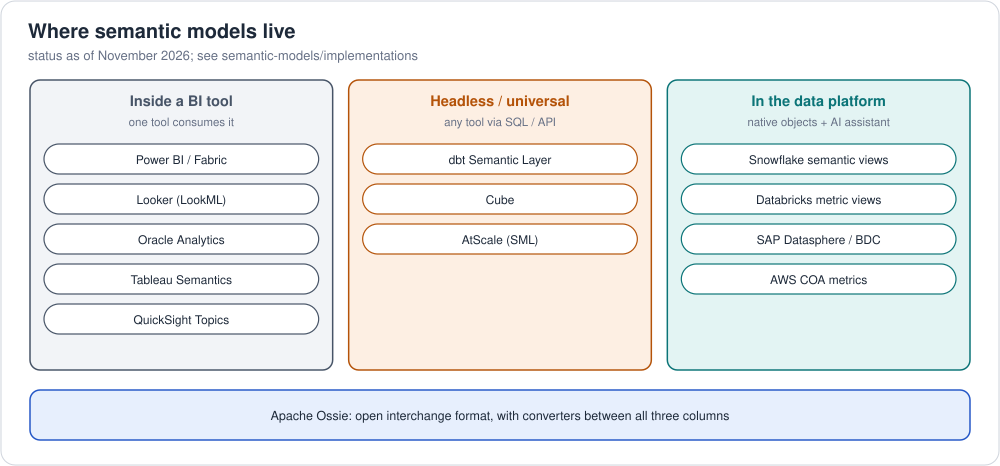

# Semantic models: implementations

Semantic layers and BI semantic models, each encoding the same retail
metrics ([`metrics.sql`](../../examples/retail/warehouse/metrics.sql)).
**Status** is as of November 2026 (details on each page).
Verification levels: [legend](../../README.md#verification-levels).

## Providers

| Provider | Product | Format | Model in your git repo | Apache Ossie | Status | Verified |
|---|---|---|---|---|---|---|
| [AWS](providers/aws/README.md) | **COA metric service** · QuickSight datasets + Topics | JSON (API) · UI/API | via API files | — | open source · GA | 🟡 COA metrics run in CI |
| [Google Cloud](providers/gcp/README.md) | **Looker** · Knowledge Catalog (ingests 6 formats) | LookML | built in | converters | GA | ⚪ |
| [Microsoft](providers/microsoft/README.md) | **Power BI / Fabric semantic model** | TMDL + DAX (PBIP) | Fabric Git integration | Microsoft joined; TMDL converter | GA | ⚪ |
| [Oracle](providers/oracle/README.md) | **Oracle Analytics** RPD / Semantic Modeler | RPD (MDS XML) / SMML JSON | Semantic Modeler Git integration | — | GA | ⚪ design only |
| [Snowflake](providers/snowflake/README.md) | **Semantic views** (+ Autopilot, Cortex Analyst) | SQL DDL / YAML | via CI | founding member | GA (Autopilot GA Feb 2026) | ⚪ |
| [Databricks](providers/databricks/README.md) | **Metric views** (+ Genie) | YAML 1.1 | via Asset Bundles | converter | GA | ⚪ |
| [Salesforce](providers/salesforce/README.md) | **Tableau Semantics** (Data 360) | metadata (JSON) | — (Ossie import/export) | co-founder | GA (Tableau Next / Data 360) | ⚪ |
| [SAP](providers/sap/README.md) | **Datasphere / Business Data Cloud** analytic models | CSN (JSON) | via transports | — | GA | ⚪ |

## Tools

| Tool | Format | Model in your git repo | Apache Ossie | Verified |
|---|---|---|---|---|
| [dbt Semantic Layer (MetricFlow)](tools/dbt/README.md) | YAML | native | converter | ✅ executed in CI |
| [AtScale](tools/atscale/README.md) | SML (YAML) | native | supporter | 🟡 |
| [Cube](tools/cube/README.md) | YAML / JS | native | converter | 🟡 |
| Apache Ossie (vendor-neutral) | YAML / JSON | native | — | ✅ [retail model](../../examples/retail/semantic-model/ossie/) |

Where each tool stores its model and how it's promoted:
[semantic models concepts 3](../concepts/03-semantic-model-repositories.md).
Planned: Qlik, ThoughtSpot, MicroStrategy, Omni, Lightdash.
